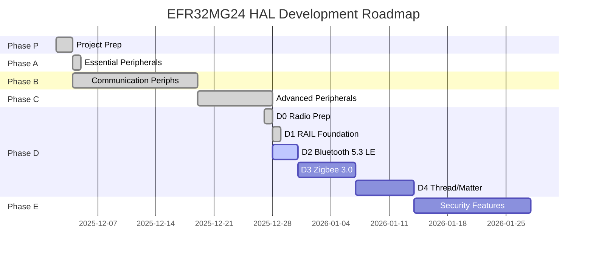

# EFR32MG24 Rust Support

Rust Peripheral Access Crate (PAC) and Hardware Abstraction Layer (HAL) for Silicon Labs EFR32MG24 wireless SoCs.


```
--------> This project is under deep implementation process!! use with caution!


- Almost finished the bluetooth support (easier than i thought) now, comparing other vendors implementation.
- Silabs forum's topic on the bricked device: https://community.silabs.com/s/question/0D7Vm00000DHJRlKAP
- Actually, I do have a bricked board, Seeed support is useless (you can't post on the forums, email is inexistent!)
- That’s my first attempt at supporting a mcu in rust (lots of research using llm's for best practices) so please, be patient :)

```


> ✅ **Status**: Phase D2 In Progress - Bluetooth 5.3 LE Integration (50% complete)

## Overview

This project aims to provide first-class Rust support for the Silicon Labs EFR32MG24 family of wireless microcontrollers. The EFR32MG24 is a powerful ARM Cortex-M33 based SoC with integrated 2.4 GHz radio supporting Zigbee, Thread, Matter, and Bluetooth LE protocols.

### Target Device

**EFR32MG24A020F1536GM48**:
- **Core**: ARM Cortex-M33 @ 78 MHz with FPU, DSP, and TrustZone
- **Memory**: 1536 KB Flash, 256 KB RAM
- **Radio**: 2.4 GHz multiprotocol (Matter, Zigbee 3.0, Thread, BLE 5.3)
- **Security**: Secure Vault with hardware crypto acceleration
- **Package**: 48-pin QFN

## Project Structure

```
EFR32MG24/
├── efr32mg24-pac/              # Peripheral Access Crate (register-level)
├── efr32mg24-hal/              # Hardware Abstraction Layer (driver-level)
├── efr32mg24-bluetooth-sys/    # Bluetooth 5.3 LE stack (BGAPI FFI bindings)
├── efr32mg24-rail-sys/         # RAIL radio abstraction (FFI bindings)
├── xiao-mg24-bsp/              # Board Support Package (XIAO MG24 Sense)
├── docs/                       # Documentation, plans, and findings
├── CLAUDE.md                   # Project instructions for Claude Code
└── README.md                   # This file
```

## Current Status

### Project Timeline



### Phase Progress

| Phase | Focus | Status | Progress |
|-------|-------|--------|----------|
| **P** | Project Preparation | ✅ Complete | 4/4 (100%) |
| **A** | Essential Peripherals | ✅ Complete | 3/3 (100%) |
| **B** | Communication | ✅ Complete | 4/4 (100%) |
| **C** | Advanced Peripherals | ✅ Stage 1 Complete | 5/5 Stage 1 (DMA Stage 2-4 deferred) |
| **D0** | Radio Preparation | ✅ Complete | 3/3 (100%) |
| **D1** | RAIL Foundation | ✅ Complete | 1/1 (100%) |
| **D2** | Bluetooth 5.3 LE | 🔄 In Progress | 2/4 (50%) |
| **D3** | Zigbee 3.0 | ⏳ Planned | 0/4 (0%) |
| **D4** | Thread/Matter | ⏳ Planned | 0/4 (0%) |
| **E** | Security Features | ⏳ Planned | 0/3 (0%) |

### Project Metrics

**Crates**: 5 total
- efr32mg24-pac (138,448 lines, 133 peripherals)
- efr32mg24-hal (12 peripheral modules)
- efr32mg24-rail-sys (3,974 FFI bindings)
- efr32mg24-bluetooth-sys (4,307 BGAPI bindings)
- xiao-mg24-bsp (board support package)

**HAL Modules**: 12 production-ready drivers
- Phase A: clock, gpio, delay (3 modules)
- Phase B: usart, i2c, spi, timer (4 modules)
- Phase C: adc, dma, emu, rtc, wdog (5 modules)

**Examples**: 21 working examples
- HAL examples: 14 (covering all 12 modules)
- BLE examples: 4 (bluetooth-sys/examples/)
- BSP examples: 3 (xiao-mg24-bsp/examples/)

**Build Status**: All examples compile successfully with zero errors

### ✅ Completed Phases

**Phase P - D1** (December 2-28, 2025):
- Project Preparation (research, PAC generation, build system)
- Essential Peripherals (GPIO, CMU, Delay)
- Communication Peripherals (USART, I2C, SPI, Timer/PWM)
- Advanced Peripherals (ADC, DMA, EMU, RTC, WDOG)
- RAIL Foundation (efr32mg24-rail-sys with 3,974 FFI bindings)

**Phase D2 - Bluetooth 5.3 LE** 🔄 (December 28, 2025 - 50% Complete):
- ✅ efr32mg24-bluetooth-sys crate with BGAPI bindings (4,307 lines)
- ✅ 6 working BLE examples (beacon, GATT, custom services, BSP integration)
- ⏳ XiaoBle BSP implementation
- ⏳ Additional BLE protocol features

### Next Up

- [ ] **D2-BLE.3**: Complete XiaoBle BSP implementation
- [ ] **D3**: Zigbee 3.0 protocol stack integration
- [ ] **D4**: Thread/Matter support
- [ ] **Phase E**: Security features (AES, SHA, Secure Vault)

## PAC (Peripheral Access Crate)

### Generation Success

The PAC has been successfully generated from Silicon Labs official SVD files for the Seeed Studio XIAO MG24 Sense hardware.

**Target Device**: EFR32MG24B220F1536IM48-B (B-series, high-power radio variant)

**SVD Source**:
- Silicon Labs Gecko Platform DFP 2025.6.2
- 41 device variants available (27 A-series + 14 B-series)
- Official distribution from Silicon Labs CMSIS-Pack

**Generated PAC**:
- 138,448 lines of Rust code (14 MB source)
- 133 peripherals accessible
- Compilation time: ~2.6 minutes
- Output: 112 MB .rlib
- Edition 2021

**Critical Issue Resolved**:
- Initial SVD files from community repo (A020) didn't match hardware (B220)
- Obtained official DFP pack with all 41 EFR32MG24 variants
- Selected correct B220 SVD for XIAO MG24 Sense hardware
- Previous A020 PAC preserved in `efr32mg24-pac/src_backup_a020/` for reference

### PAC Generation Commands

```bash
# Install svd2rust with locked dependencies (required)
cargo install svd2rust --locked  # v0.37.1

# Generate PAC from SVD
cd efr32mg24-pac
svd2rust -i svd/EFR32MG24B220F1536IM48.svd \
         --target cortex-m \
         -o src/

# Format and build
cargo fmt
cargo build --target thumbv8m.main-none-eabihf
```

**Important**: Use `--locked` flag to pin transitive dependencies. Without it, version conflicts cause proc-macro2 errors.

### Documentation

See detailed PAC documentation:
- [docs/pac/SVD_PACK_EXTRACTION.md](docs/pac/SVD_PACK_EXTRACTION.md) - How we obtained all 41 SVD files from official DFP pack
- [docs/pac/B220_VS_A020_COMPARISON.md](docs/pac/B220_VS_A020_COMPARISON.md) - B220 vs A020 peripheral comparison
- [docs/hardware/XIAO_MG24_HARDWARE.md](docs/hardware/XIAO_MG24_HARDWARE.md) - Target hardware specifications

## Development Plan

See [docs/PLAN.md](docs/PLAN.md) for the complete development roadmap.

**Current Progress: Phase B Complete (100%)**

1. ✅ **Phase 1-4**: Project Setup, PAC Generation, PAC Verification
2. ✅ **Phase A**: HAL Core - GPIO, CMU, Delay with hardware register access
3. ✅ **Phase B**: HAL Communication - USART, I2C, SPI, Timers/PWM all production-ready
4. ⏳ **Phase C**: HAL Advanced - ADC, DMA, Power Management
5. ⏳ **Phase 8-9**: Testing, Examples, Ecosystem (Embassy, BSPs)

## Documentation

**Complete documentation index**: [docs/README.md](docs/README.md)

### Quick Links

- **[docs/STATUS.md](docs/STATUS.md)** - Current project status (what's done, what's next)
- **[docs/PLAN.md](docs/PLAN.md)** - Development roadmap (9-phase plan)
- **[docs/hardware/XIAO_MG24_HARDWARE.md](docs/hardware/XIAO_MG24_HARDWARE.md)** - Target hardware details
- **[docs/pac/B220_VS_A020_COMPARISON.md](docs/pac/B220_VS_A020_COMPARISON.md)** - Current PAC analysis
- **[docs/hal/HAL_STRUCTURE_PLAN.md](docs/hal/HAL_STRUCTURE_PLAN.md)** - HAL architecture plan
- **[CLAUDE.md](CLAUDE.md)** - Project instructions for Claude Code

## Why EFR32MG24?

The EFR32MG24 is particularly interesting for Rust embedded development:

- **Modern Architecture**: Cortex-M33 with TrustZone (memory safety + Rust safety = 🎯)
- **Wireless Protocols**: Native support for Matter, Thread, Zigbee (growing IoT markets)
- **Low Power**: Sub-µA sleep modes ideal for battery applications
- **Security Features**: Hardware crypto + Secure Vault + Rust = maximum security
- **Untapped Market**: No existing Rust support for Series 2 devices (pioneer opportunity)

## Related Projects

### Similar Chip Families

- [stm32-rs](https://github.com/stm32-rs/stm32-rs) - STM32 family (most mature)
- [nrf-rs](https://github.com/nrf-rs/nrf-hal) - Nordic nRF52/53 (excellent HAL)
- [rp-rs](https://github.com/rp-rs/rp-hal) - Raspberry Pi RP2040 (official support)
- [esp-rs](https://github.com/esp-rs/esp-hal) - Espressif ESP32 (vendor-backed)

### Silicon Labs Rust (Legacy)

- [efm32-rs](https://github.com/efm32-rs) - EFM32 Series 0/1 only (last update 2023)
- [em32-rs](https://github.com/em32-rs/wg) - Working group (largely inactive)
- [chrysn/efm32gg-hal](https://github.com/chrysn/efm32gg-hal) - Minimal GPIO-only HAL

**Note**: None of the above support EFR32 Series 2 devices (MG21/MG24/MG26).

## Prerequisites

### Software

- Rust 1.70+ with `thumbv8m.main-none-eabihf` target
- svd2rust (PAC generation)
- form (code organization)
- cargo-binutils (optional, for binary inspection)

### Hardware (for testing)

- xG24-DK2601B EFR32MG24 Development Kit (~$50)
- J-Link debug probe or Silicon Labs WSTK board
- Silicon Labs Simplicity Commander (for flashing)

## Building

```bash
# Install Rust target for Cortex-M33
rustup target add thumbv8m.main-none-eabihf

# Install svd2rust with locked dependencies (if regenerating PAC)
cargo install svd2rust --locked

# Build workspace
cargo build --release --target thumbv8m.main-none-eabihf
```

**Build Results**:
- PAC: 112 MB .rlib with 133 peripherals
- HAL: ~25 KB .rlib with GPIO, CMU, Delay implementations
- Build Time: ~3 minutes (release mode)
- Clean Compilation: ✅ No errors or warnings

## Contributing

This project is in early development. Contributions are welcome!

Areas where help is needed:
- HAL peripheral implementations (GPIO, USART, I2C, SPI, Timers, ADC, etc.)
- Testing on hardware (xG24-DK2601B dev kit)
- Documentation and examples
- embedded-hal v1.0 trait implementations
- Embassy async support

## Resources

### Official Silicon Labs

- [EFR32MG24 Product Page](https://www.silabs.com/wireless/zigbee/efr32mg24-series-2-socs)
- [Silicon Labs Community](https://community.silabs.com/)
- [Simplicity SDK](https://github.com/SiliconLabs/simplicity_sdk) (C/C++)

### Rust Embedded

- [Embedded Rust Book](https://docs.rust-embedded.org/book/)
- [embedded-hal](https://github.com/rust-embedded/embedded-hal)
- [awesome-embedded-rust](https://github.com/rust-embedded/awesome-embedded-rust)
- [Rust Embedded Matrix Chat](https://matrix.to/#/#rust-embedded:matrix.org)

### SVD & Code Generation

- [CMSIS-SVD Specification](https://www.keil.com/pack/doc/CMSIS/SVD/html/)
- [svd2rust](https://github.com/rust-embedded/svd2rust)
- [svdtools](https://github.com/stm32-rs/svdtools) (SVD patching)

### SVD Files Source

- [cortex-debug-dp-efr32mg24](https://github.com/silabs-EricB/cortex-debug-dp-efr32mg24)
- ARM Keil Device Family Packs

## License

Licensed under either of:

- Apache License, Version 2.0 ([LICENSE-APACHE](LICENSE-APACHE) or http://www.apache.org/licenses/LICENSE-2.0)
- MIT license ([LICENSE-MIT](LICENSE-MIT) or http://opensource.org/licenses/MIT)

at your option.

### Contribution

Unless you explicitly state otherwise, any contribution intentionally submitted for inclusion in the work by you, as defined in the Apache-2.0 license, shall be dual licensed as above, without any additional terms or conditions.

## Acknowledgments

- Silicon Labs for the EFR32MG24 SoC and documentation
- Rust Embedded Working Group for tooling and guidance
- stm32-rs project for organizational patterns
- All contributors to the Rust embedded ecosystem

---

**Project Status**: Phase D2 In Progress - Bluetooth 5.3 LE integration (efr32mg24-bluetooth-sys + examples)
**Last Updated**: 2025-12-28
**Maintainer**: Marcelo Correa <mvcorrea+github@gmail.com>
**Repository**: https://github.com/bitscrafts/EFR32MG2X-RS
