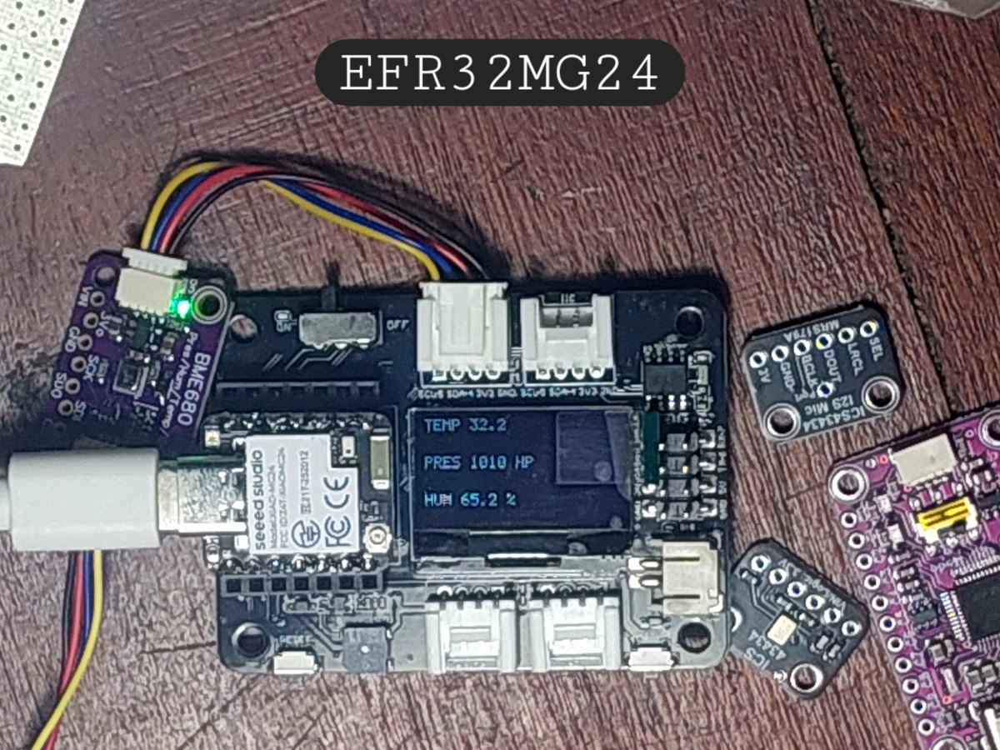
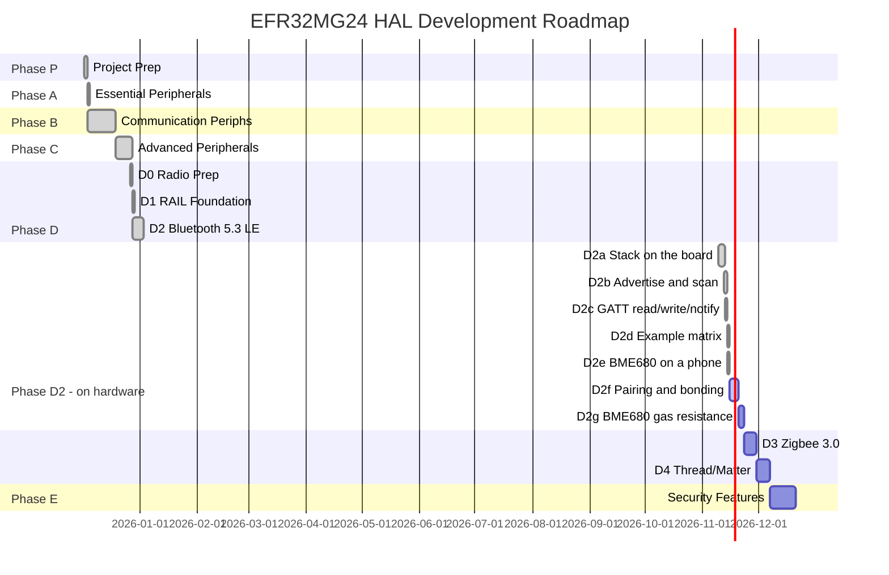

# EFR32MG24 Rust Support



*XIAO MG24 Sense in the XIAO Expansion Base running `base_env_display`: the panel carries the BME680's compensated
readings (temperature, pressure, humidity), with the sensor and a microphone breakout beside it.*

Rust Peripheral Access Crate (PAC) and Hardware Abstraction Layer (HAL) for Silicon Labs EFR32MG24 wireless SoCs.


```
--------> This project is under deep implementation process!! use with caution!

- Managed to unbrick the board, proceed with testing.
- Almost finished the bluetooth support (easier than i thought) now, comparing other vendors implementation.
- Silabs forum's topic on the bricked device: https://community.silabs.com/s/question/0D7Vm00000DHJRlKAP
- Actually, I do have a bricked board, Seeed support is useless (you can't post on the forums, email is inexistent!)
- That’s my first attempt at supporting a mcu in rust (lots of research using llm's for best practices) so please, be patient :)

```

> **Documentation**: https://bitscrafts.github.io/EFR32MG2X-RS/efr32mg24_hal/index.html

> ✅ **Status**: Bluetooth 5.3 LE works on hardware -- beacon advertising, scanning, connections, a GATT server with
> read, write and notify, and the BME680 published as the standard Environmental Sensing service, verified on a phone.
> Pairing (D2f) and the BME680 gas reading (D2g) are the open items; see "The BLE part, honestly" below. Next phases:
> D3 (Zigbee) / Phase E (Application Development).

## Overview

This project aims to provide first-class Rust support for the Silicon Labs EFR32MG24 family of wireless microcontrollers. The EFR32MG24 is a powerful ARM Cortex-M33 based SoC with integrated 2.4 GHz radio supporting Zigbee, Thread, Matter, and Bluetooth LE protocols.

### Target Device

**EFR32MG24B220F1536IM48-B** (Seeed Studio XIAO MG24 Sense):
- **Core**: ARM Cortex-M33 @ 78 MHz with FPU, DSP, and TrustZone
- **Memory**: 1536 KB Flash, 256 KB RAM
- **Radio**: 2.4 GHz multiprotocol (Matter, Zigbee 3.0, Thread, BLE 5.3)
- **Security**: Secure Vault with hardware crypto acceleration
- **Package**: 48-pin QFN (B-series, high-power radio variant)

## Project Structure

```
EFR32MG24/
├── crates/efr32mg24-pac/              # Peripheral Access Crate (register-level)
├── crates/efr32mg24-hal/              # Hardware Abstraction Layer (driver-level)
├── crates/efr32mg24-bluetooth-sys/    # Bluetooth 5.3 LE stack (BGAPI FFI bindings)
├── crates/efr32mg24-rail-sys/         # RAIL radio abstraction (FFI bindings)
├── crates/xiao-mg24-bsp/              # Board Support Package (XIAO MG24 Sense)
├── docs/                       # Documentation, plans, and findings
├── CLAUDE.md                   # Project instructions for Claude Code
└── README.md                   # This file
```

## Current Status

### Project Timeline



### Phase Progress

| Phase | Focus | Status | Progress |
|-------|-------|--------|----------|
| **P** | Project Preparation | ✅ Complete | 4/4 (100%) |
| **A** | Essential Peripherals | ✅ Complete | 3/3 (100%) |
| **B** | Communication | ✅ Complete | 4/4 (100%) |
| **C** | Advanced Peripherals | ✅ Stage 1 Complete | 5/5 Stage 1 (DMA Stage 2-4 deferred) |
| **D0** | Radio Preparation | ✅ Complete | 3/3 (100%) |
| **D1** | RAIL Foundation | ✅ Complete | 1/1 (100%) |
| **D2** | Bluetooth 5.3 LE | ✅ Complete | 5/5 (100%) |
| **D2a** | Stack on the board | ✅ Complete | 1/1 (100%) |
| **D2b** | Advertise and scan | ✅ Complete | 2/2 (100%) |
| **D2c** | GATT read/write/notify | ✅ Complete | 3/3 (100%) |
| **D2d** | Example matrix on hardware | ✅ Complete | 13/13 examples run |
| **D2e** | BME680 on a phone | ✅ Complete | 3/3 characteristics |
| **D2f** | Pairing and bonding | ⏳ Open | 0/1 (PSA layer done, security manager open) |
| **D2g** | BME680 gas resistance | ⏳ Planned | 0/1 |
| **D3** | Zigbee 3.0 | ⏳ Planned | 0/4 (0%) |
| **D4** | Thread/Matter | ⏳ Planned | 0/4 (0%) |
| **E** | Security Features | ⏳ Planned | 0/3 (0%) |

### Project Metrics

**Crates**: 12 total
- efr32mg24-pac (138,448 lines, 133 peripherals)
- efr32mg24-hal (12 peripheral modules)
- efr32mg24-radio (Bluetooth API, RAIL, diagnostics)
- efr32mg24-rail-sys (3,974 FFI bindings)
- efr32mg24-bluetooth-sys (4,307 BGAPI bindings)
- efr32mg24-emlib-sys, efr32mg24-bt-stubs, cmsis-stubs (C interop for the vendor blobs)
- xiao-mg24-bsp (XIAO MG24 Sense)
- xiao-expansion-base-bsp (XIAO Expansion Base)
- efr32mg24-bootloader, bootloader-test-app

**Libraries** (`libraries/`): bt-heap, aes-modes, aes-ctr-radio, motion-detection -- `no_std`, tested on the host

**HAL Modules**: 12 production-ready drivers
- Phase A: clock, gpio, delay (3 modules)
- Phase B: usart, i2c, spi, timer (4 modules)
- Phase C: adc, dma, emu, rtc, wdog (5 modules)

**Examples**: 83 files, 26 of them checked by `scripts/check-examples-build.sh` across the PAC, HAL, radio and BSP levels
- The Bluetooth and BSP examples declare `required-features`, so a plain `cargo build --examples` skips them silently;
  that script names each one with its features and fails if any does not compile.

**Build Status**: All examples compile successfully with zero errors; `scripts/gate.sh` reports `VERDICT: PASS`

### ✅ Completed Phases

**Phase P - D1** (December 2-28, 2025):
- Project Preparation (research, PAC generation, build system)
- Essential Peripherals (GPIO, CMU, Delay)
- Communication Peripherals (USART, I2C, SPI, Timer/PWM)
- Advanced Peripherals (ADC, DMA, EMU, RTC, WDOG)
- RAIL Foundation (efr32mg24-rail-sys with 3,974 FFI bindings)

**Phase D2 - Bluetooth 5.3 LE** ✅ (December 28, 2025 - January 3, 2026 - Complete):
- ✅ efr32mg24-bluetooth-sys crate with BGAPI bindings (4,307 lines) + safe blocking API
- ✅ XiaoBle BSP: advertiser + GATT server + event system with automatic connection management
- ✅ XiaoBle safe wrapper (80% code reduction vs raw FFI)
- ✅ 10 BLE/sensor examples (4 bluetooth-sys FFI + 6 BSP integration)
- ✅ BLE Event System (poll_event, automatic connection management)
- ✅ C2-DMA.2: LDMA peripheral-to-memory transfers with circular buffers
- ✅ D2-MIC.1: MSM381ACT001 analog microphone driver (16 kHz audio streaming)

### Next Up

- [ ] **D2f**: Bluetooth pairing and bonding (the PSA layer is written and verified; the security manager fails before the key exchange)
- [ ] **D2g**: BME680 gas resistance (heater, `res_heat` and the `par_g*` curves)
- [ ] **D3**: Zigbee 3.0 protocol stack integration
- [ ] **D4**: Thread/Matter support
- [ ] **Phase E**: Security features (AES, SHA, Secure Vault)
- [ ] **C2-DMA.3/4**: Linked descriptors and interrupt-driven async DMA
- [ ] **C6-Test**: Hardware validation on XIAO MG24 Sense

### What runs on the board today (measured, 2026-11-14)

Every row below was measured on hardware with a machine watching the radio from outside. The board's own report is
never the evidence: an example whose job is to transmit passes only when something else sees it on the air.

| example | layer | what proves it |
|---|---|---|
| `pac_led_blink`, `hal_led_blink`, `module_led_blink`, `base_led_blink` | PAC → BSP | the pin is read back toggling, not assumed |
| `pac_bme680`, `pac_env_display`, `base_env_display` | PAC → BSP | compensated temperature, pressure and humidity, on the panel |
| `hal_mic_level`, `module_mic_level` | HAL | RMS over 128 samples, the LED follows the level |
| `hal_imu_read`, `module_imu` | HAL | accelerometer identity and three axes |
| `ble_beacon` | radio | `Name (complete): xiao-mg24` seen by a scanner |
| `ble_scanner` | radio | decodes a known address, with a control run that does not |
| `ble_advertise_custom` | radio | a 9-byte manufacturer frame with a live counter |
| `ble_gatt` | radio | a client connects, reads, writes and subscribes; the firmware echoes the written bytes in its notifications |
| `base_ble_env_gatt` | BSP | the BME680 as a standard Environmental Sensing service, read and notified, verified on a phone |
| `module_ble_beacon`, `module_ble_motion`, `module_ble_fall`, `base_ble_env` | BSP | sensor data in the advertising payload |
| `ble_diag`, `ble_boot_probe`, `ble_rail_then_stack` | radio | transmit counters, boot status, crystal frequency |

### The BLE part, honestly

**Works:** advertising (connectable and not), scanning, connections, a GATT server with read, write and notify, and a
sensor published as the standard `0x181A` Environmental Sensing service -- temperature `0x2A6E`, humidity `0x2A6F`,
pressure `0x2A6D`. A generic phone app labels and decodes those without any profile document from us.

**Does not work, and is not in the product build:** pairing and bonding. The security manager is a catalogue option
that is deliberately off. With it enabled a pairing request is accepted and then fails at a DHKey check **without any
cryptographic function being called** (`pg=0 pe=0 pa=0`), which puts the fault before the key exchange rather than in
it. See [`docs/04-reference/BLE-STATUS.md`](docs/04-reference/BLE-STATUS.md).

**The advertising rate is unmeasured.** The only adapter available captures roughly 8% of what is on the air, so counts
cannot be turned into a rate without a controllable receiver.

### Quick start

```bash
# Everything the gate checks: build every crate, clippy at zero, host tests, examples, message buffers
bash scripts/gate.sh

# Every example with the features it declares (the Bluetooth and BSP ones are skipped by `cargo --examples`)
bash scripts/check-examples-build.sh

# Flash one example and run it. The script refuses a load address that would overwrite the bootloader and verifies
# the image by reading it back.
cargo build --release --target thumbv8m.main-none-eabihf -p efr32mg24-radio \
  --example ble_gatt --features "ble gatt stack"
FLASH_HOST=<bench-host> bash scripts/flash.sh \
  target/thumbv8m.main-none-eabihf/release/examples/ble_gatt --confirm --run
```

`FLASH_HOST` is the machine the debug probe is attached to; the scripts reach it over SSH and speak to the target with
OpenOCD. Nothing in the repository depends on a particular host.

### A note on the evidence

Several checks here exist because a green check once passed while the thing it checked was broken: a scan that
reported nothing because the *scanner* was the bottleneck, a GATT read answered from the host's cache, a mailbox
record that survived a reset and was read as the current one. Where a document states a result, it states how it was
measured and what would make it false.


## PAC (Peripheral Access Crate)

### Generation Success

The PAC has been successfully generated from Silicon Labs official SVD files for the Seeed Studio XIAO MG24 Sense hardware.

**Target Device**: EFR32MG24B220F1536IM48-B (B-series, high-power radio variant)

**SVD Source**:
- Silicon Labs Gecko Platform DFP 2025.6.2
- 41 device variants available (27 A-series + 14 B-series)
- Official distribution from Silicon Labs CMSIS-Pack

**Generated PAC**:
- 138,448 lines of Rust code (14 MB source)
- 133 peripherals accessible
- Compilation time: ~2.6 minutes
- Output: 112 MB .rlib
- Edition 2021

**Critical Issue Resolved**:
- Initial SVD files from community repo (A020) didn't match hardware (B220)
- Obtained official DFP pack with all 41 EFR32MG24 variants
- Selected correct B220 SVD for XIAO MG24 Sense hardware
- Previous A020 PAC preserved in `crates/efr32mg24-pac/src_backup_a020/` for reference

### PAC Generation Commands

```bash
# Install svd2rust with locked dependencies (required)
cargo install svd2rust --locked  # v0.37.1

# Generate PAC from SVD
cd efr32mg24-pac
svd2rust -i svd/EFR32MG24B220F1536IM48.svd \
         --target cortex-m \
         -o src/

# Format and build
cargo fmt
cargo build --target thumbv8m.main-none-eabihf
```

**Important**: Use `--locked` flag to pin transitive dependencies. Without it, version conflicts cause proc-macro2 errors.

### Documentation

See detailed PAC documentation:
- [docs/04-reference/pac/SVD_PACK_EXTRACTION.md](docs/04-reference/pac/SVD_PACK_EXTRACTION.md) - How we obtained all 41 SVD files from official DFP pack
- [docs/04-reference/pac/B220_VS_A020_COMPARISON.md](docs/04-reference/pac/B220_VS_A020_COMPARISON.md) - B220 vs A020 peripheral comparison
- [docs/04-reference/hardware/XIAO_MG24_HARDWARE.md](docs/04-reference/hardware/XIAO_MG24_HARDWARE.md) - Target hardware specifications

## Development Plan

See [docs/03-development/PLAN.md](docs/03-development/PLAN.md) for the complete development roadmap.

**Current Progress: Phase D2 Complete (Bluetooth 5.3 LE)**

1. **Phase P**: Project Setup, PAC Generation, build system (complete)
2. **Phase A**: HAL Core - GPIO, CMU, Delay with hardware register access (complete)
3. **Phase B**: HAL Communication - USART, I2C, SPI, Timers/PWM (complete)
4. **Phase C**: HAL Advanced - ADC, DMA (Stages 1-2), EMU, RTC, WDOG (complete)
5. **Phase D0-D1**: Radio Foundation - RAIL FFI bindings (complete)
6. **Phase D2**: Bluetooth 5.3 LE - BGAPI stack, XiaoBle BSP, microphone driver (complete)
7. **Phase D3-D4**: Zigbee 3.0, Thread/Matter (planned)
8. **Phase E**: Security features (AES, SHA, Secure Vault) (planned)
9. **Future**: Hardware testing, Embassy async, ecosystem

## Documentation

**Complete documentation index**: [docs/INDEX.md](docs/INDEX.md)

### Quick Links

- **[docs/INDEX.md](docs/INDEX.md)** - Complete documentation index
- **[docs/03-development/STATUS.md](docs/03-development/STATUS.md)** - Current project status (what's done, what's next)
- **[docs/03-development/PLAN.md](docs/03-development/PLAN.md)** - Development roadmap (9-phase plan)
- **[docs/04-reference/hardware/XIAO_MG24_HARDWARE.md](docs/04-reference/hardware/XIAO_MG24_HARDWARE.md)** - Target hardware details
- **[docs/04-reference/pac/B220_VS_A020_COMPARISON.md](docs/04-reference/pac/B220_VS_A020_COMPARISON.md)** - Current PAC analysis
- **[docs/02-architecture/hal/HAL_STRUCTURE_PLAN.md](docs/02-architecture/hal/HAL_STRUCTURE_PLAN.md)** - HAL architecture plan
- **[scripts/README.md](scripts/README.md)** - Build and flashing scripts documentation
- **[CLAUDE.md](CLAUDE.md)** - Project instructions for Claude Code

## Why EFR32MG24?

The EFR32MG24 is particularly interesting for Rust embedded development:

- **Modern Architecture**: Cortex-M33 with TrustZone (memory safety + Rust safety = 🎯)
- **Wireless Protocols**: Native support for Matter, Thread, Zigbee (growing IoT markets)
- **Low Power**: Sub-µA sleep modes ideal for battery applications
- **Security Features**: Hardware crypto + Secure Vault + Rust = maximum security
- **Untapped Market**: No existing Rust support for Series 2 devices (pioneer opportunity)

## Related Projects

### Similar Chip Families

- [stm32-rs](https://github.com/stm32-rs/stm32-rs) - STM32 family (most mature)
- [nrf-rs](https://github.com/nrf-rs/nrf-hal) - Nordic nRF52/53 (excellent HAL)
- [rp-rs](https://github.com/rp-rs/rp-hal) - Raspberry Pi RP2040 (official support)
- [esp-rs](https://github.com/esp-rs/esp-hal) - Espressif ESP32 (vendor-backed)

### Silicon Labs Rust (Legacy)

- [efm32-rs](https://github.com/efm32-rs) - EFM32 Series 0/1 only (last update 2023)
- [em32-rs](https://github.com/em32-rs/wg) - Working group (largely inactive)
- [chrysn/efm32gg-hal](https://github.com/chrysn/efm32gg-hal) - Minimal GPIO-only HAL

**Note**: None of the above support EFR32 Series 2 devices (MG21/MG24/MG26).

## Prerequisites

### Software

- Rust 1.70+ with `thumbv8m.main-none-eabihf` target
- svd2rust (PAC generation)
- form (code organization)
- cargo-binutils (optional, for binary inspection)

### Hardware (for testing)

- xG24-DK2601B EFR32MG24 Development Kit (~$50)
- J-Link debug probe or Silicon Labs WSTK board
- Silicon Labs Simplicity Commander (for flashing)

## Building

```bash
# Install Rust target for Cortex-M33
rustup target add thumbv8m.main-none-eabihf

# Install svd2rust with locked dependencies (if regenerating PAC)
cargo install svd2rust --locked

# Build workspace
cargo build --release --target thumbv8m.main-none-eabihf
```

**Build Results**:
- PAC: 112 MB .rlib with 133 peripherals
- HAL: 12 production-ready peripheral modules (GPIO, CMU, Delay, USART, I2C, SPI, Timer, ADC, DMA, EMU, RTC, WDOG)
- Build Time: ~3 minutes (release mode)
- Clean Compilation: ✅ No errors or warnings

## Contributing

This project is in early development. Contributions are welcome!

Areas where help is needed:
- HAL peripheral implementations (GPIO, USART, I2C, SPI, Timers, ADC, etc.)
- Testing on hardware (xG24-DK2601B dev kit)
- Documentation and examples
- embedded-hal v1.0 trait implementations
- Embassy async support

## Resources

### Official Silicon Labs

- [EFR32MG24 Product Page](https://www.silabs.com/wireless/zigbee/efr32mg24-series-2-socs)
- [Silicon Labs Community](https://community.silabs.com/)
- [Simplicity SDK](https://github.com/SiliconLabs/simplicity_sdk) (C/C++)

### Rust Embedded

- [Embedded Rust Book](https://docs.rust-embedded.org/book/)
- [embedded-hal](https://github.com/rust-embedded/embedded-hal)
- [awesome-embedded-rust](https://github.com/rust-embedded/awesome-embedded-rust)
- [Rust Embedded Matrix Chat](https://matrix.to/#/#rust-embedded:matrix.org)

### SVD & Code Generation

- [CMSIS-SVD Specification](https://www.keil.com/pack/doc/CMSIS/SVD/html/)
- [svd2rust](https://github.com/rust-embedded/svd2rust)
- [svdtools](https://github.com/stm32-rs/svdtools) (SVD patching)

### SVD Files Source

- [cortex-debug-dp-efr32mg24](https://github.com/silabs-EricB/cortex-debug-dp-efr32mg24)
- ARM Keil Device Family Packs

## License

Licensed under either of:

- Apache License, Version 2.0 ([LICENSE-APACHE](LICENSE-APACHE) or http://www.apache.org/licenses/LICENSE-2.0)
- MIT license ([LICENSE-MIT](LICENSE-MIT) or http://opensource.org/licenses/MIT)

at your option.

### Contribution

Unless you explicitly state otherwise, any contribution intentionally submitted for inclusion in the work by you, as defined in the Apache-2.0 license, shall be dual licensed as above, without any additional terms or conditions.

## Acknowledgments

- Silicon Labs for the EFR32MG24 SoC and documentation
- Rust Embedded Working Group for tooling and guidance
- stm32-rs project for organizational patterns
- All contributors to the Rust embedded ecosystem

---

**Project Status**: Phase D2 Complete - Bluetooth 5.3 LE integration done (HAL + RAIL FFI + Bluetooth stack + XiaoBle BSP + microphone driver)
**Last Updated**: 2026-06-28
**Maintainer**: Marcelo Correa <mvcorrea+github@gmail.com>
**Repository**: https://github.com/bitscrafts/EFR32MG2X-RS
