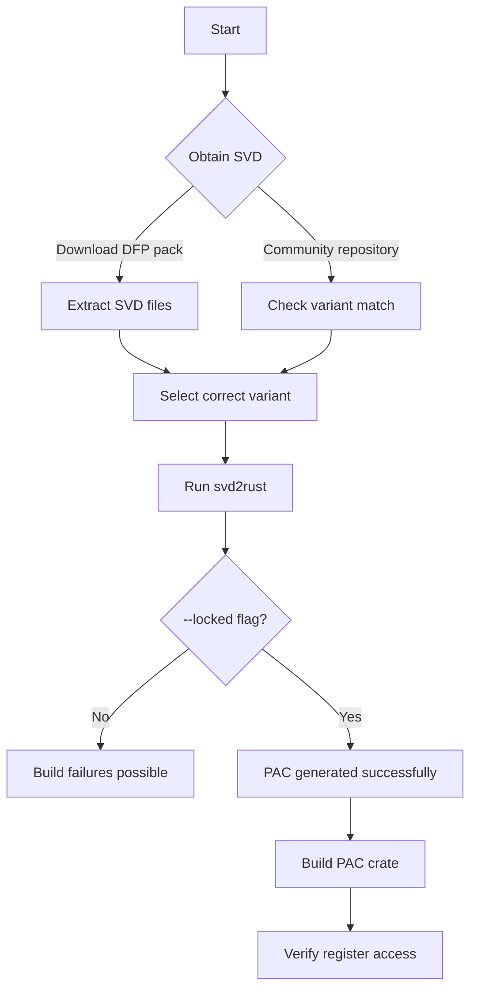
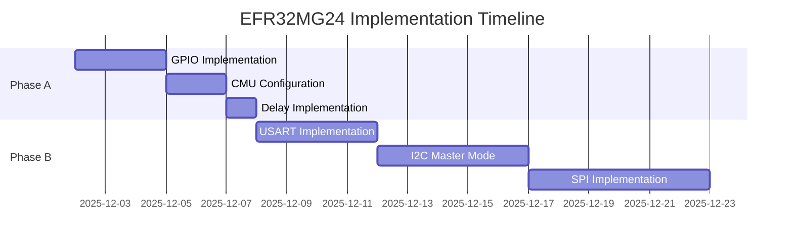

# Book Writing Guide: Implementing Rust Support for Embedded Hardware
## A Comprehensive Guide Based on EFR32MG24 Implementation

---

## Executive Summary

This document provides complete instructions for writing "Implementing Rust Support for Embedded Hardware: A Complete Guide Using EFR32MG24." The book serves as both a practical tutorial and comprehensive reference for developers who want to bring Rust support to new embedded hardware.

**Target Audience**: Intermediate Rust developers with minimal embedded systems experience
**Scope**: Complete implementation from PAC generation through production HAL, BSP, and protocol stacks
**Approach**: Test-driven, example-rich, with real EFR32MG24 implementation as reference

---

## 1. Book Philosophy and Core Principles

### 1.1 Pedagogical Approach

**The "Learn by Implementing" Method**
- Readers implement each peripheral alongside the book
- Every chapter includes working, compilable code examples
- Test-driven development reinforces understanding
- Real hardware validation (when possible) or simulation

**Incremental Complexity**
- Chapter progression follows natural learning curve organized into 4 parts:

  **Part I: PAC Generation and Foundation (Ch 1-3)**
  - Chapter 1: Introduction to embedded Rust and bare-metal programming
  - Chapter 2: SVD files and PAC generation process
  - Chapter 3: Build systems, cross-compilation, and debugging

  **Part II: Hardware Abstraction Layer (Ch 4-9)**
  - Chapter 4: GPIO implementation with type-safe pin modes
  - Chapter 5: Clock management and system configuration
  - Chapter 6: USART serial communication
  - Chapter 7: I2C master mode protocol
  - Chapter 8: SPI master mode (three variants: USART, EUSART0, EUSART1)
  - Chapter 9: Advanced peripherals (DMA, ADC, EMU, RTC, WDOG)

  **Part III: Wireless Protocol Stacks (Ch 10-14)**
  - Chapter 10: Test-Driven Development and quality assurance
  - Chapter 11: RAIL radio abstraction layer foundation
  - Chapter 12: Bluetooth 5.3 Low Energy stack (BGAPI, GAP, GATT)
  - Chapter 13: Zigbee 3.0 mesh networking protocol
  - Chapter 14: Thread and Matter integration (IPv6, OpenThread, Matter commissioning)

  **Part IV: Board Support Packages and Production (Ch 15-18)**
  - Chapter 15: BSP design and hardware abstraction
  - Chapter 16: Documentation strategies and project management
  - Chapter 17: Production deployment and ecosystem integration
  - Chapter 18: Complete project walkthrough from zero to production

- 5 Appendices with reference materials, troubleshooting, and protocol comparisons

**"Why" Before "How"**
- Explain design decisions, not just implementation
- Compare alternatives with trade-off analysis
- Show common mistakes and how to avoid them
- Reference patterns from production codebases

### 1.2 Technical Writing Standards

**Code Quality**
- All examples compile without warnings
- Follow `rustfmt` and `clippy` recommendations
- Include complete context (Cargo.toml, dependencies)
- Show incremental evolution (before/after states)

**Clarity and Precision**
- Define terms before first use (glossary cross-references)
- Use consistent terminology throughout
- Balance technical depth with accessibility
- Include "TL;DR" summaries for complex sections

**Practical Focus**
- Real-world EFR32MG24 implementation as primary reference
- problems actually encountered during implementation
- Show debugging techniques and troubleshooting
- Include performance considerations and trade-offs

**Build and Flash Integration**
- Every chapter includes build examples showing cargo commands and output
- Hardware-integrated chapters include flash examples with probe-rs
- Debug vs release builds compared for size and optimization
- Binary analysis and verification techniques
- Real hardware testing where applicable

**Comprehensive Protocol Coverage**
- All major wireless protocols supported by EFR32MG24: Bluetooth LE, Zigbee, Thread, Matter
- Protocol-specific implementation details and challenges
- RAIL foundation enabling multi-protocol support
- Real-world application examples for each protocol

---

## 2. Chapter-by-Chapter Writing Guidelines

### Chapter 1: Introduction to Embedded Rust

**Key Messages:**
- Rust's unique value proposition for embedded systems
- PAC/HAL/BSP pattern is industry standard (not arbitrary)
- Embedded development requires different mindset

**Writing Approach:**
- Start with relatable problems (memory safety bugs in C)
- Use concrete examples: buffer overflows, use-after-free
- Show Rust compiler catching these at compile time
- Transition to embedded-specific benefits (resource constraints, direct hardware access)

**Diagram Requirements:**
- Memory safety comparison (C vs Rust timeline diagram)
- PAC/HAL/BSP layered architecture with concrete examples
- Repository structure tree with actual files

**Code Examples:**
- Simple GPIO blink (C vs Rust comparison)
- Unsafe Rust with justification
- Type-safe pin mode transitions

**Exercises:**
1. Set up development environment
2. Install required tools
3. Run first example
4. Explore PAC documentation

---

### Chapter 2: SVD Files and PAC Generation

**Critical Section: The A020 vs B020 Discovery**

This is one of the most important lessons in the book. Many developers new to embedded Rust:

1. Find first SVD file they can
2. Generate PAC
3. Write code that compiles
4. **Wonder why nothing works on hardware**

**Writing Strategy:**
- Narrate the discovery as a detective story
  - Something's not right (subtle hardware differences)
  - Investigation (comparing SVD files)
  - Solution (official DFP packs)
  - Prevention (validation strategies)

**Hands-on Exercise:**
Readers will:
1. Download DFP pack for their target MCU
2. Extract and examine SVD file structure
3. Verify device variant matches hardware
4. Generate PAC and verify register addresses

**svd2rust Deep Dive:**
- MUST use `--locked` flag (explain dependency hell)
- Output structure analysis (138k lines is normal!)
- Critical section usage patterns
- Register read/modify/write semantics

**Code Organization:**
Show directory structure before and after PAC generation
Explain why direct `src/` modification is anti-pattern

---

### Chapter 3: GPIO Implementation (Phase A1)

**TDD Approach for This Chapter:**

The book introduces Test-Driven Development here because:
1. GPIO is simple enough to test thoroughly
2. Sets pattern for subsequent peripherals
3. Tests document expected behavior
4. Catch hardware-software interface bugs early

**Red-Green-Refactor Cycle:**

```rust
// Step 1: Write failing test (Red)
#[test]
fn test_gpio_pin_output_mode() {
    // This should configure pin as output
    let pin = gpio.pa0.into_output();
    assert_eq!(pin.mode(), Output);
}

// Step 2: Implement minimal code (Green)
impl Pin {
    pub fn into_output(self) -> Pin<Output> {
        // Minimal implementation
        Pin { _mode: PhantomData }
    }
}

// Step 3: Improve (Refactor)
// Add proper register manipulation
// Add error handling
// Optimize for size/speed
```

**Type-State Pattern Explanation:**
- Why compile-time safety matters (examples of runtime bugs prevented)
- Show attempt without type-state vs with type-state
- Compiler error messages as teaching tool
- Relation to zero-cost abstractions

**Writing Strategy:**
- Show unsafe direct register access first
- Build safe abstraction layer
- Explain each safety guarantee added
- Demonstrate with examples that fail to compile

**Critical Sections Discussion:**
- Why needed (atomicity requirements)
- Trade-offs (interrupt latency)
- Hardware implications
- When to use nested critical sections

---

### Chapter 4: Clock Management

**Builder Pattern Justification:**
- Clock configuration has many interdependent parameters
- Some combinations are invalid (error prevention)
- Builder allows step-by-step configuration
- Consumer pattern prevents use before initialization

**FrozenClocks Concept:**
- Type system tracking enabled clocks
- Prevents runtime checks
- Zero-cost abstraction at work
- Connection to type-state pattern

**Writing Approach:**
- Start with manual register configuration
- Show fragility (easy to misconfigure)
- Introduce builder step by step
- Demonstrate error prevention
- Show generated code (surprisingly efficient)

---

### Chapter 5-7: Communication Peripherals

**Building Complexity Naturally:**
1. USART: Simplest async protocol
2. I2C: Add state machine complexity
3. SPI: Multiple implementations (generic programming)

**Common Thread: embedded-hal Traits**
- Consistent API across vendors
- Ecosystem compatibility
- Why trait design choices matter
- Trading implementation complexity for user simplicity

**USART Focus:**
- Baud rate calculation (show formula derivation)
- Oversampling trade-offs
- Error handling strategies
- Configurability vs simplicity

**I2C Deep Dive:**
- State machine as central concept
- Timing diagrams for each transaction type
- Clock stretching (when and why)
- Bus arbitration (multi-master scenarios)

**SPI Challenge:**
- Three different peripherals (USART, EUSART variations)
- Generic programming to avoid duplication
- Compile-time vs runtime selection
- Feature matrix comparison

**Writing Strategy for State Machines:**
- Show state transitions as enum
- Map to hardware register values
- Use loop-with-match pattern
- Add timeout handling
- Error recovery strategies

---

### Chapter 8: Advanced Peripherals

**DMA Challenges:**
- Memory-to-memory as hello world
- Peripheral-to-memory (real use case)
- Descriptor chains and linked transfers
- Interrupt handling complexity

**ADC Precision Considerations:**
- Sampling time calculations
- Reference voltage options
- Temperature drift
- Noise reduction techniques

**Power Management Nuances:**
- Sleep mode transitions
- Wake source configuration
- Peripheral state retention
- Startup time trade-offs

**Writing Approach:**
- Show simple case first
- Add complexity incrementally
- Document pitfalls we encountered
- Performance measurements

---

### Chapter 9: Build Systems

**Memory Layout Deep Dive:**
- Why linker scripts necessary (no OS)
- Typical embedded memory organization
- Section placement strategies
- Startup code requirements

**Cross-Compilation Challenges:**
- Target specification details
- No_std complexity
- Panic handlers
- Language items

**Writing Strategy:**
- Show manual invocation first
- Build up to build.rs automation
- Explain each rustflags option
- Debugging build failures

**Real-World Issue Highlight:**
Share the story of mysterious crashes due to stack alignment, solved by examining linker map files.

---

### Chapter 10: Testing Strategies

**Testing Pyramid for Embedded:**
1. Unit tests (register mocking)
2. Integration tests (QEMU where possible)
3. Hardware-in-the-loop tests
4. Manual validation tests

**Mock Register Pattern:**
```rust
#[cfg(test)]
use std::cell::RefCell;

#[cfg(test)]
thread_local! {
    static MOCK_GPIOA: RefCell<GpioA> = RefCell::new(GpioA::default());
}

#[cfg(not(test))]
use crate::pac::GPIOA;

#[cfg(test)]
use MOCK_GPIOA as GPIOA;
```

**Writing Approach:**
- For each HAL module, show testing strategy
- Include test coverage metrics
- CI/CD pipeline examples (GitHub Actions)
- Test flakiness handling

---

### Chapter 11-12: Wireless Protocols

**RAIL Abstraction Value:**
- Unified PHY layer across protocols
- Protocol-specific MAC layers
- Vendor independence
- Why we chose RAIL over direct register access

**Bluetooth LE Complexity:**
- GAP (Generic Access Profile)
- GATT (Generic Attribute Profile)
- Advertising and connections
- Security and pairing

**FFI Challenges:**
- C header conversion (bindgen)
- Callback handling (considered har` `aM
- Lifetime management
- Thread safety
- Memory allocation differences

**Writing Strategy:**
- Show raw C API first
- Build safe wrappers progressively
- Document each safety barrier added
- Memory ownership diagrams

**Safe Wrapper Design:**
- RAII for resources
- Type-safe state transitions
- Event loop abstractions
- Error propagation strategies

---

### Chapter 13: BSP Design

**BSP vs HAL Distinction:**
- HAL: Hardware-agnostic (any board with this MCU)
- BSP: Board-specific (pin mappings, onboard devices)
- Why both needed: reusability

**XIAO MG24 Specifics:**
- Onboard LED pin assignment
- QWIIC connector
- Debug pins
- Radio antenna considerations

**Writing Focus:**
- Show HAL usage in practice
- Abstraction level decisions
- User experience considerations
- Multiple board support strategies

---

### Chapter 14: Documentation

**README Pattern:**
- Module purpose and capabilities
- Usage examples (real code)
- Configuration options
- Hardware compatibility
- Implementation notes

**Phase-Based Development:**
- Why phases (organizational clarity)
- Identifier scheme benefits
- Status tracking methods
- GitHub integration

**Diagram Standards:**
- Mermaid for quick iteration (docs)
- Tikz for publication quality (book)
- Color schemes (safety: red, performance: blue, etc.)
- Consistent formatting

---

### Chapter 15: Production Deployment

**Crates.io Considerations:**
- Metadata completeness
- Documentation on docs.rs
- Version numbering strategy
- Breaking change policies

**Community Building:**
- Issue templates
- Contributing guidelines
- Code of conduct
- Release cadence

**CI/CD Pipeline:**
- Multi-target builds
- Feature flag testing
- Documentation deployment
- Automated releases

---

### Chapter 16: Complete Walkthrough

**Hands-on Project:**
Readers follow along implementing for their target MCU:
1. Create workspace structure
2. Generate PAC
3. Implement GPIO (with tests)
4. Add clock management
5. Implement USART
6. Add I2C
7. Implement SPI
8. Create examples
9. Write documentation
10. Publish to crates.io

**Testing Integration:**
- After each module: add tests
- After each phase: integration test
- Regular hardware validation
- Performance benchmarking

---

## 3. Test-Driven Development Implementation

### Why TDD for This Book?

1. **Educational Value**: Tests document expected behavior
2. **Confidence**: Know when implementation is correct
3. **Refactoring Safety**: Change implementation with confidence
4. **Real-World Pattern**: Production embedded Rust uses TDD

### Three-Tier Testing Strategy

**Tier 1: Unit Tests (Fast, Offline)**
```rust
// Mock registers for testing
#[cfg(test)]
mod tests {
    use super::*;

    #[test]
    fn test_gpio_configure_output() {
        // Given: GPIO pin in default state
        let mut mock_gpio = MockGpio::new();

        // When: Configure as output
        mock_gpio.configure_output(Pin::PA0, DriveStrength::Standard);

        // Then: Verify register writes
        assert_eq!(mock_gpio.model().read(), 0x4); // Push-pull output
    }
}
```

**Tier 2: Integration Tests (Requires QEMU/Hardware)**
```rust
// Test actual hardware interactions
#[test]
fn test_gpio_led_blink() {
    let mut board = Board::new();
    board.led.toggle().unwrap();
    thread::sleep_ms(100);
    board.led.toggle().unwrap();
    // Visual verification or automated with photodiode
}
```

**Tier 3: Hardware Validation (Manual/Electrical)**
- Oscilloscope measurements
- Logic analyzer captures
- Power consumption measurements
- Temperature testing

### Test Organization in Book

Each peripheral chapter includes:
1. **Test Setup**: Infrastructure needed
2. **Red Phase**: Write failing tests
3. **Green Phase**: Minimal implementation
4. **Refactor Phase**: Improve code quality
5. **Coverage Analysis**: What might we have missed?

---

## 4. Code Example Management

### Example Structure

```
book/project/
├── chapter-03-gpio/              # Chapter 3 examples
│   ├── examples/
│   │   ├── 01_basic_output.rs
│   │   ├── 02_input_reading.rs
│   │   └── 03_interrupts.rs
│   ├── src/
│   │   ├── lib.rs
│   │   └── gpio/
│   ├── Cargo.toml
│   └── tests/
│       └── gpio_tests.rs
├── chapter-05-usart/
│   └── ...
└── complete-workspace/           # Chapter 16 full project
    ├── Cargo.toml
    ├── efr32mg24-pac/
    ├── efr32mg24-hal/
    └── examples/
```

### Code Synchronization Strategy

Since actual implementation evolves while book is written:

1. **Initial Copy**: Copy working code to book/project/
2. **Adaptation**: Simplify/remove project-specific complexity
3. **Documentation**: Add extensive comments
4. **Verification**: Ensure examples compile independently
5. **Periodic Sync**: Every chapter completion, sync with actual implementation

### Code Annotation Standards

```rust
/// Configure a GPIO pin as output
///
/// # Safety
///
/// This function is safe because:
/// 1. We take ownership of the pin (preventing concurrent access)
/// 2. Configuration is atomic (critical section protection)
/// 3. The pin is returned in a known state (type-state pattern)
///
/// [book: chapter-03-gpio, section-03-04]
pub fn into_output(self) -> Pin<PORT, PIN, Output<PushPull>> {
    critical_section::with(|_cs| {
        let gpio = unsafe { &*Gpio::ptr() };

        // Configure pin mode in MODEL/MODEH register
        // [book: chapter-03-gpio, figure-03-01]
        if PIN < 8 {
            gpio.model().modify(|r, w| unsafe {
                w.bits((r.bits() & !(0xF << (PIN * 4))) | (0x4 << (PIN * 4)))
            });
        } else {
            let pin = PIN - 8;
            gpio.modeh().modify(|r, w| unsafe {
                w.bits((r.bits() & !(0xF << (pin * 4))) | (0x4 << (pin * 4)))
            });
        }
    });

    // Return type-safe pin in output mode
    // [book: chapter-03-gpio, section-03-03]
    Pin {
        _mode: PhantomData,
    }
}
```

### Command Examples

Show actual commands with expected output:

```bash
$ cargo build --release
   Compiling efr32mg24-pac v0.1.0
   Compiling efr32mg24-hal v0.1.0
    Finished release [optimized] target(s) in 2.6m
```

---

## 5. Diagram Generation Standards

### Tikz Diagram Standards

**Architecture Diagrams:**
```latex
\begin{tikzpicture}[
    layer/.style={rectangle, draw=black, thick, minimum width=6cm, minimum height=1.5cm},
    arrow/.style={-Latex, thick}
]

% Application Layer
\node[layer, fill=blue!20] (app) {Application};

% BSP Layer
\node[layer, fill=green!20, below=of app] (bsp) {Board Support Package};

% HAL Layer
\node[layer, fill=yellow!20, below=of bsp] (hal) {Hardware Abstraction Layer};

% PAC Layer
\node[layer, fill=red!20, below=of hal] (pac) {Peripheral Access Crate};

% Hardware
\node[layer, fill=gray!20, below=of pac] (hw) {Hardware Peripherals};

% Arrows
\draw[arrow] (app) -- (bsp);
\draw[arrow] (bsp) -- (hal);
\draw[arrow] (hal) -- (pac);
\draw[arrow] (pac) -- (hw);

% Annotations
\node[right=1cm of app, text width=4cm, align=left] {User Code};
\node[right=1cm of bsp, text width=4cm, align=left] {Board-Specific};
\node[right=1cm of hal, text width=4cm, align=left] {Portable API};
\node[right=1cm of pac, text width=4cm, align=left] {Register Access};

\end{tikzpicture}
```

**State Machine Diagrams:**
```latex
\begin{tikzpicture}[
    state/.style={circle, draw=black, thick, minimum size=2cm},
    transition/.style={-Latex, thick},
    label/.style={midway, above, sloped}
]

\node[state, fill=green!20] (idle) {IDLE};
\node[state, fill=yellow!20, right=of idle] (start) {START};
\node[state, fill=blue!20, right=of start] (addr) {ADDRESS};
\node[state, fill=red!20, right=of addr] (data) {DATA};
\node[state, fill=gray!20, below=of addr] (stop) {STOP};

\draw[transition] (idle) -- node[label] {START\\condition} (start);
\draw[transition] (start) -- node[label] {Address sent} (addr);
\draw[transition] (addr) -- node[label] {ACK received} (data);
\draw[transition] (data) -- node[label] {Data complete} (stop);
\draw[transition] (stop) -- node[label] {STOP sent} (idle);

\end{tikzpicture}
```

### Mermaid Diagram Standards

**Flowcharts for Documentation:**


**Gantt Charts for Project Planning:**


### Diagram Consistency Rules

1. **Color Coding:**
   - Green: Success states/happy path
   - Yellow: Intermediate states
   - Red: Error states/critical sections
   - Blue: Data flow/peripheral access

2. **Layout Standards:**
   - Flow direction: Top-to-bottom or left-to-right
   - Consistent node sizing within diagrams
   - Clear labels on all arrows
   - Legend for all symbols

3. **Numbering:**
   - All figures numbered by chapter (e.g., Figure 3-1)
   - Cross-references in code comments
   - Reference in text before showing diagram

---

## 6. LLM/Human Collaboration Workflow

### Skill Definition: "Book Writer"

**Core Competencies (from user requirements):**

1. **Deep Subject-Matter Expertise**
   - Embedded Rust architecture patterns
   - PAC/HAL/BSP design principles
   - EFR32MG24 hardware specifics
   - RTIC, Embassy, async patterns

2. **Excellent Technical Writing Skills**
   - Rust documentation standards
   - Technical book authoring
   - Code example design
   - Tutorial structure

3. **Ability to Explain Complexity Simply**
   - Complex concepts through analogies
   - Progressive disclosure
   - Before/after comparisons
   - Multiple explanation paths

4. **Information Architecture**
   - TOC design and flow
   - Cross-reference management
   - Search term optimization
  -  Prerequisite tracking

5. **Research and Fact-Verification**
   - Reference manual cross-checking
   - Implementation validation
   - Community best practices
   - Alternative approaches

6. **Tool Proficiency**
   - LaTeX (with TikZ, minted)
   - Mermaid diagram generation
   - Rustdoc and cargo tools
   - Git/GitHub workflows

7. **Editing and Revision Discipline**
   - Self-review checklists
   - Consistency enforcement
   - Technical accuracy verification
   - Reader feedback integration

8. **Communication and Collaboration**
   - Clear progress reporting
   - Receptive to technical review
   - Iterative improvement mindset
   - Reader persona awareness

9. **Empathy for Reader**
   - Anticipate common confusion points
   - Provide multiple learning paths
   - Include troubleshooting sections
   - Balance depth with accessibility

10. **Lifelong Learning**
    - Track evolving embedded Rust ecosystem
    - Update book with new patterns
    - Monitor community discussions
    - Incorporate reader feedback

### Writing Workflow

**Phase 1: Outline and Research**
1. Review TOC for chapter
2. Research related documentation
3. Identify key concepts
4. Design example code
5. Create rough outline

**Phase 2: Draft Writing**
1. Write section headings
2. Add code examples
3. Create diagrams
4. Write explanatory text
5. Add exercises

**Phase 3: Technical Review**
1. Verify code compiles
2. Check register addresses
3. Validate technical details
4. Review for clarity
5. Add missing context

**Phase 4: Integration**
1. Update cross-references
2. Add to master TOC
3. Create chapter summary
4. Add to index/glossary
5. Update project examples

**Phase 5: Reader Testing**
1. Fresh reader attempts examples
2. Identify confusion points
3. Revise unclear sections
4. Add FAQ entries
5. Improve flow

### Content Generation with LLM

**When writing with LLM assistance:**

1. **Structural Prompting:**
   ```
   Write a section about USART baud rate calculation (about 3 pages).
   Include:
   - Formula derivation
   - Oversampling explanation
   - Error calculation
   - Code example showing calculation
   - Table of common baud rates

   Reference actual EFR32MG24 implementation from:
   - efr32mg24-hal/src/usart/mod.rs:120-180
   - efr32mg24-hal/src/usart/types.rs:45-60

   Target audience: Intermediate Rust developers
   Tone: Conversational but technical
   Include three diagrams: timing, formula, and decision tree
   ```

2. **Review and Refinement:**
   - Fact-check all technical claims
   - Verify code compiles
   - Check against reference manual
   - Ensure consistent terminology
   - Add book-specific cross-references

3. **Human Touch Areas:**
   - Anecdotes from actual implementation
   - Debugging stories
   - Alternative approaches considered
   - Why certain decisions made
   - Common pitfalls experienced

### Code Extraction from Real Implementation

**Automated Extraction:**
```bash
# Extract specific function
sed -n '100,150p' efr32mg24-hal/src/gpio/mod.rs

# Extract with context
git show HEAD:efr32mg24-hal/src/gpio/mod.rs | sed -n '100,150p'

# Find all implementations of pattern
rg "pub fn into_output" efr32mg24-hal/src/ -n
```

**Manual Curation:**
1. Extract relevant code sections
2. Simplify (remove project-specific details)
3. Add comprehensive comments
4. Create executable examples
5. Verify independence from book context

**Synchronization Schedule:**
- After completing each chapter
- When fixing bugs in actual implementation
- Before major book milestones
- After community feedback

---

## 7. Remote Compilation Setup

### Container Environment

**Dockerfile:**
```dockerfile
FROM rust:latest

# Install TeX Live with all packages
RUN apt-get update && apt-get install -y \
    texlive-full \
    texlive-latex-extra \
    texlive-fonts-extra \
    texlive-science \
    texlive-pictures \
    python3-pygments \
    poppler-utils \
    rsync \
    && rm -rf /var/lib/apt/lists/*

# Install LaTeX packages
RUN tlmgr install \
    minted \
    fvextra \
    ifplatform \
    xstring \
    catchfile

# Set up build directory
WORKDIR /build

# Copy build script
COPY build-book.sh /usr/local/bin/
RUN chmod +x /usr/local/bin/build-book.sh

CMD ["build-book.sh"]
```

**Build Script (build-book.sh):**
```bash
#!/bin/bash
set -e

echo "Building Embedded Rust book..."

# Create output directory
mkdir -p /output

# Compile with XeLaTeX (for better font support)
xelatex -shell-escape main.tex

# Run BibTeX if bibliography exists
if [ -f "main.bib" ]; then
    bibtex main
    xelatex -shell-escape main.tex
    xelatex -shell-escape main.tex
fi

# Copy output
if [ -f "main.pdf" ]; then
    cp main.pdf /output/book.pdf
    echo "Build successful: /output/book.pdf"
else
    echo "Build failed!"
    exit 1
fi
```

### Synchronization Workflow

**Local to Remote:**
```bash
#!/bin/bash
# sync-and-build.sh

BOOK_HOST="book-builder.local"
BOOK_DIR="/Users/${FLASH_USER:-$(id -un)}/Private/20250626_rust_projects/2025-10-29/EFR32MG24/book"

# Sync latex files
echo "Syncing LaTeX files to build host..."
rsync -avz --progress \
    --exclude='*.pdf' \
    --exclude='*.aux' \
    --exclude='*.log' \
    --exclude='*.out' \
    "$BOOK_DIR/latex/" \
    "$BOOK_HOST:/build/"

# Trigger build (can be automated)
echo "Triggering remote build..."
ssh "$BOOK_HOST" "cd /build && ./build-book.sh"

# Retrieve PDF if successful
if ssh "$BOOK_HOST" "test -f /output/book.pdf"; then
    echo "Retrieving built PDF..."
    rsync -avz "$BOOK_HOST:/output/book.pdf" "$BOOK_DIR/output/"
    echo "Book built successfully: $BOOK_DIR/output/book.pdf"
else
    echo "Build failed! Check remote logs."
    ssh "$BOOK_HOST" "cat /build/main.log" | tail -50
fi
```

**Continuous Build Option:**
```bash
# Watch for file changes
while true; do
    inotifywait -r -e modify,create,delete "$BOOK_DIR/latex/"
    echo "Changes detected, rebuilding..."
    ./sync-and-build.sh
done
```

### Build Output Structure

```
book/
├── output/
│   ├── book.pdf              # Final PDF
│   ├── draft.pdf             # Draft version (with TODOs)
│   └── chapter-pdfs/         # Individual chapters
│       ├── chapter-01.pdf
│       ├── chapter-02.pdf
│       └── ...
```

### Error Handling

**Compilation Errors:**
- Log full error output
- Parse LaTeX errors for line numbers
- Map to source files
- Provide helpful remediation

**Sync Failures:**
- Network connectivity checks
- SSH key validation
- Disk space verification
- Permission issues

---

## 8. Integration with Actual EFR32MG24 Project

### Code Sharing Strategy

**Symbolic Links (Optional):**
```bash
# For chapters heavily tied to actual code
ln -s /Users/${FLASH_USER:-$(id -un)}/Private/20250626_rust_projects/2025-10-29/EFR32MG24/efr32mg24-hal/src/gpio \
      book/project/chapter-03-gpio/src/gpio
```

**Selective Copy Strategy (Recommended):**
```bash
# Copy only what we need
rsync -av --include='*.rs' --include='*.toml' --exclude='*' \
      efr32mg24-hal/src/gpio/ \
      book/project/chapter-03-gpio/src/
```

### Documentation Cross-References

**Book to Implementation:**
```rust
/// Configure USART baud rate
///
/// # Implementation Details
///
/// See [EFR32MG24 Reference Manual, Section 25.3.3](efr32mg24_rm.pdf)
/// and actual implementation: efr32mg24-hal/src/usart/mod.rs:45-67
///
/// [book: chapter-05-usart, section-05-02]
```

**Implementation to Book:**
```rust
/// Configure USART0 for serial communication
///
/// # Chapter Reference
/// See "Chapter 5: USART Implementation" in the Embedded Rust book
/// for detailed explanation of baud rate calculation and configuration.
///
/// [book: chapter-05-usart, example-05-01]
pub fn init(&mut self, config: Config) -> Result<(), Error> {
    // ... implementation
}
```

### Update Workflows

**When Implementation Changes:**
1. Identify affected book sections
2. Update code examples
3. Check if technical explanations still valid
4. Update diagrams if architecture changed
5. Add change log entry

**Version Tracking:**
- Tag book versions with implementation versions
- Document breaking changes
- Migration guide sections
- Deprecation warnings

### Issue Tracking Integration

**Linking to GitHub Issues:**
```rust
/// Workaround for probe-rs flashing issue
///
/// See GitHub issue #23 for detailed discussion:
/// https://github.com/bitscrafts/EFR32MG2X-RS/issues/23
/// [book: appendix-c-troubleshooting, section-flashing]
```

---

## 9. Book Completion Checklist

### Content Completeness

- [ ] All chapters written (16 + appendices)
- [ ] Every chapter has exercises
- [ ] Code examples compile independently
- [ ] TDD approach demonstrated in key chapters
- [ ] Mermaid diagrams included in margin
- [ ] Tikz diagrams in main content
- [ ] Cross-references accurate
- [ ] Glossary complete
- [ ] Index generated

### Technical Accuracy

- [ ] All register addresses verified
- [ ] All code examples tested
- [ ] SVD generation steps validated
- [ ] Build instructions work on clean machine
- [ ] Troubleshooting section addresses real issues
- [ ] Performance claims benchmarked
- [ ] Security considerations discussed

### Production Quality

- [ ] PDF compiles without errors or warnings
- [ ] Table of contents accurate
- [ ] Page numbers correct
- [ ] Figures captioned
- [ ] Tables formatted consistently
- [ ] Code highlighting correct
- [ ] Bibliography complete
- [ ] Back matter (index, glossary) generated

### Accessibility

- [ ] Clear learning path for beginners
- [ ] Advanced sections marked
- [ ] Multiple explanation styles (text, diagram, code)
- [ ] Troubleshooting for common issues
- [ ] External references for deeper dives
- [ ] Exercises at various difficulty levels

### Community Readiness

- [ ] Code repository public
- [ ] Examples in separate repository
- [ ] Issue tracker set up
- [ ] Contribution guidelines
- [ ] Feedback mechanism
- [ ] Errata tracking process

---

## 10. Future Extensions

### Advanced Topics (Future Editions)

1. **Embassy and Async Rust**
   - Async/await for embedded
   - Executor design
   - Task scheduling

2. **Real-Time Constraints**
   - RTIC framework
   - Priority management
   - Deadline scheduling

3. **Security Features**
   - Secure vault integration
   - Trusted execution
   - Secure boot

4. **Multi-Core Considerations**
   - Inter-core communication
   - Shared memory
   - Synchronization primitives

5. **Protocol Deep Dives**
   - Custom BLE profiles
   - Mesh networking
   - Custom protocols

### Companion Materials

1. **Video Course**: Screen recordings of implementation
2. **Interactive Labs**: Browser-based examples
3. **Hardware Kits**: Pre-configured dev boards
4. **Community Forum**: Discussion and support
5. **Reference Cards**: Quick lookup tables

---

## 11. Getting Started (For Book Writers)

### Initial Setup

```bash
# Clone the repository
git clone https://github.com/bitscrafts/EFR32MG2X-RS
cd EFR32MG2X-RS

# Create book directory structure
mkdir -p book/{latex/{diagrams,figures},project}

# Copy TOC and README
cp TOC.yml book/
cp README.md book/

# Add to gitignore
echo "book/output/" >> .gitignore
echo "book/project/*/target/" >> .gitignore

# Start writing!
cd book/latex
touch main.tex
```

### Writing Environment

**Recommended Tools:**
- Text editor: VS Code with Rust and LaTeX extensions
- PDF viewer: Zathura (auto-reloads on changes)
- Diagram editor: Draw.io for prototyping
- Version control: Git with detailed commit messages

**Useful Scripts:**
```bash
# Format book code
find book/project -name "*.rs" -exec rustfmt {} \;

# Spell-check (install aspell)
find book/latex -name "*.tex" -exec aspell check {} \;

# Word count
find book/latex -name "*.tex" -exec wc -w {} + | tail -1

# Code line count
find book/project -name "*.rs" -exec wc -l {} + | tail -1
```

### Chapter Writing Template

```latex
\chapter{Chapter Title}
\label{ch:chapter-id}

\section{Section Title}
\label{sec:section-id}

Opening paragraph setting context and explaining importance.

\begin{lstlisting}[language=rust, caption={Descriptive caption}]
// Code example here
\end{lstlisting}

Explanation of code, line by line where helpful.

\begin{figure}[ht]
\centering
% Diagram here (Tikz or includegraphics)
\caption{Descriptive figure caption}
\label{fig:figure-id}
\end{figure}

Reference to figure: as shown in Figure \ref{fig:figure-id}.

\subsection{Subsection Title}
\label{subsec:subsection-id}

More detailed content...

\section{Key Takeaways}

\begin{itemize}
\item Key point 1
\item Key point 2
\item Key point 3
\end{itemize}

\section{Exercises}

\begin{enumerate}
\item Exercise 1 (beginner)
\item Exercise 2 (intermediate)
\item Exercise 3 (advanced)
\end{enumerate}
```

---

## 12. Conclusion

This book represents a unique opportunity to document the complete process of bringing Rust support to new embedded hardware. Unlike manufacturer datasheets or academic papers, it combines:

- **Practical Implementation**: Real EFR32MG24 code
- **Pedagogical Rigor**: Incremental learning progression
- **Production Quality**: Patterns from mature ecosystems
- **Community Benefit**: Comprehensive reference

The book's value extends beyond EFR32MG24, providing a roadmap for other chip families and establishing patterns for the broader embedded Rust ecosystem.

**Next Steps:**
1. Review TOC and approach with stakeholders
2. Set up writing environment
3. Begin with Chapter 1 (foundations)
4. Iterate based on early reader feedback
5. Expand to full book systematically

---

**Document Information**
- Version: 1.0.0
- Last Updated: 2026-01-04
- Next Review: After TOC and approach approval
- Contact: marcelo@bitscrafts.com
- Repository: https://github.com/bitscrafts/EFR32MG2X-RS

---

**Change Log**

| Version | Date | Author | Changes |
|---------|------|--------|---------|
| 1.0.0 | 2026-01-04 | Marcelo Correa | Initial book writing guide |
