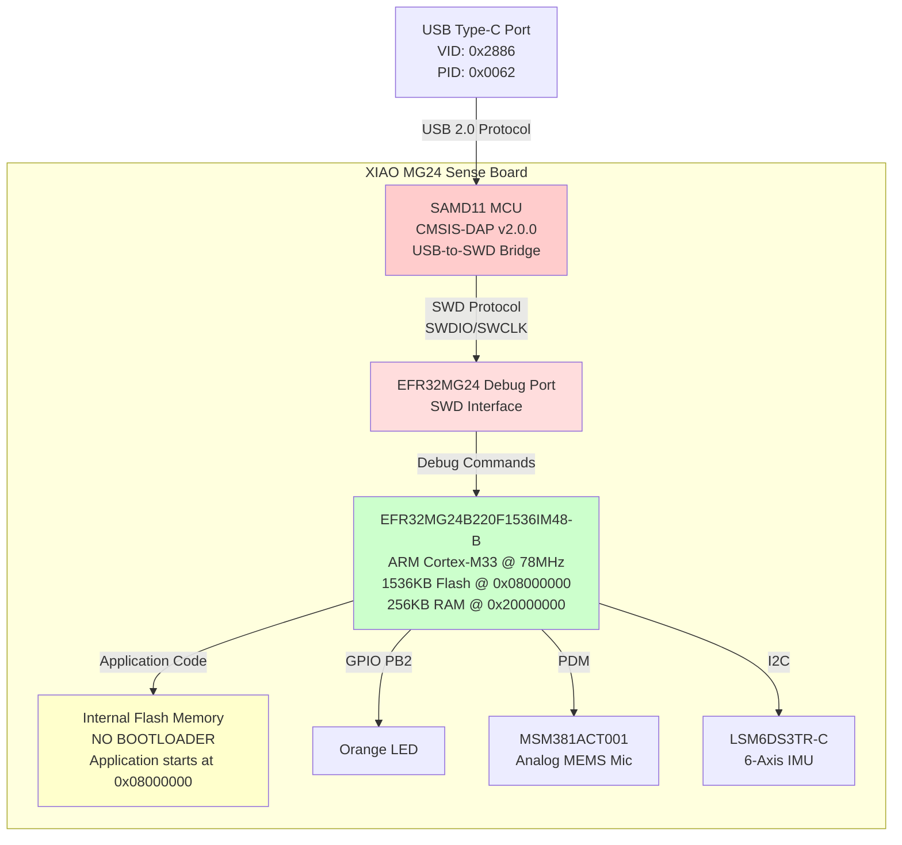
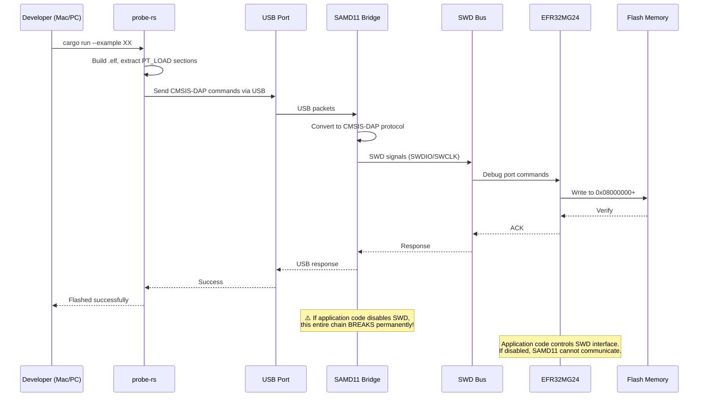
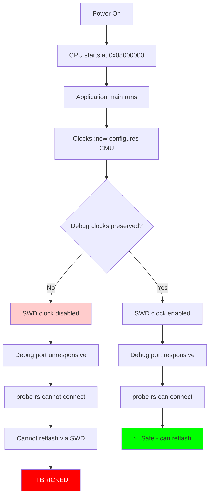
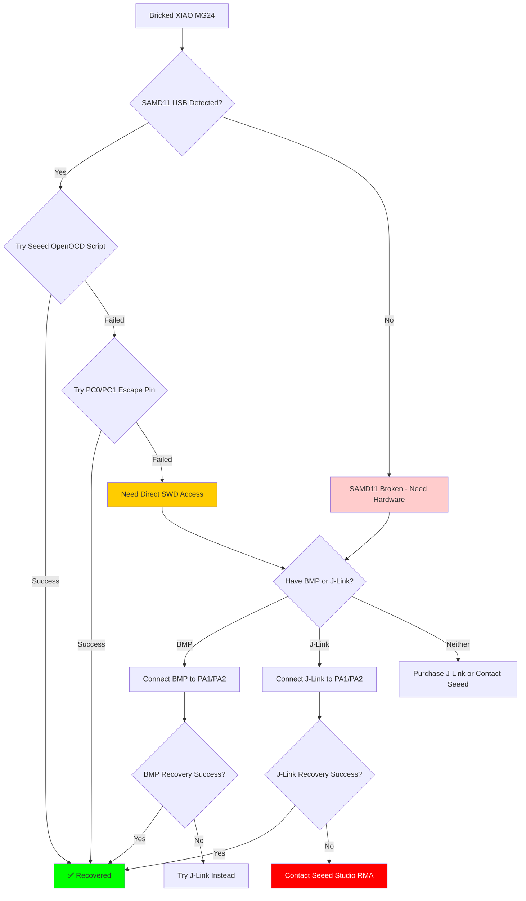
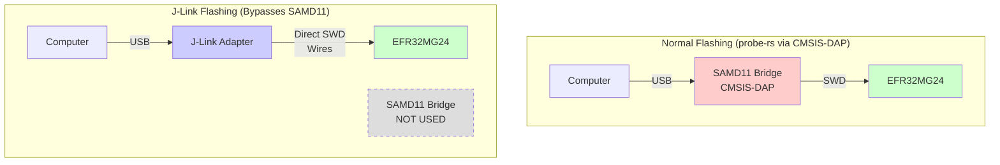
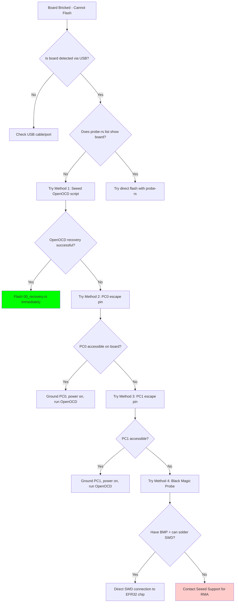
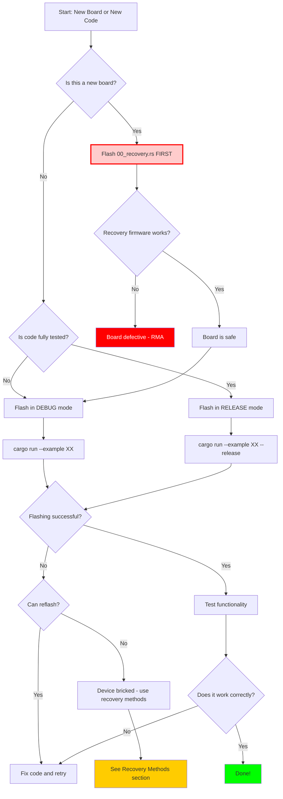

# XIAO MG24 Comprehensive Flashing and Recovery Guide

**Date**: December 26, 2025
**Board**: Seeed Studio XIAO MG24 Sense (EFR32MG24B220F1536IM48-B)
**Status**: Authoritative Reference - Single Source of Truth
**Purpose**: Complete guide for safe flashing, recovery, and prevention

---

## Table of Contents

1. [Quick Reference](#quick-reference)
2. [Architecture Overview](#architecture-overview)
3. [SAMD11 Bridge: Critical Understanding](#samd11-bridge-critical-understanding)
4. [Safe Flashing Procedures](#safe-flashing-procedures)
5. [What Can Brick Your Device](#what-can-brick-your-device)
6. [Recovery Methods](#recovery-methods)
7. [Current Board Status](#current-board-status)
8. [Prevention Measures](#prevention-measures)
9. [Future Workflow](#future-workflow)
10. [References](#references)

---

## Quick Reference

### Emergency Commands

```bash
# Check if board is detected
probe-rs list

# Flash recovery firmware (SAFEST)
cd efr32mg24-hal
cargo run --example 00_recovery --features rt --release

# Check USB connection
ls /dev/cu.usbmodem*

# Official Seeed recovery (if software methods fail)
cd xiao_mg24_flash_erase_macos
./xiao_mg24_erase.sh
```

### Critical Safety Rules

| ✅ DO | ❌ DON'T |
|-------|----------|
| ✅ Flash 00_recovery.rs FIRST on new boards | ❌ NEVER disable SWD clocks in development |
| ✅ Use debug builds during development | ❌ NEVER flash raw .elf files directly |
| ✅ Preserve debug clocks in ALL examples | ❌ NEVER test clock code on your only board |
| ✅ Use probe-rs for flashing | ❌ NEVER enter DeepSleep without escape pin |
| ✅ Keep recovery firmware ready | ❌ NEVER use --release until fully tested |

---

## Architecture Overview

### Complete System Architecture



### Flash Memory Layout

```
EFR32MG24B220 Flash Memory (NO BOOTLOADER)
┌──────────────────────────────────────────┐ 0x08000000
│  Reset Vector (SP initial value)         │ 0x08000000
│  Reset Handler address                   │ 0x08000004
├──────────────────────────────────────────┤
│  Interrupt Vector Table                  │ 0x08000008 - 0x08000XXX
├──────────────────────────────────────────┤
│                                          │
│  Application Code                        │
│  (User firmware)                         │
│                                          │
│  NO BOOTLOADER PARTITION                 │
│  NO RECOVERY PARTITION                   │
│  NO SAFE MODE                            │
│                                          │
└──────────────────────────────────────────┘ 0x08180000 (1536KB end)

⚠️ CRITICAL: Application runs DIRECTLY from 0x08000000
⚠️ NO SAFETY NET: Corrupted firmware = Bricked device
⚠️ NO FACTORY RESTORE: Factory firmware not downloadable
```

**Comparison with Other XIAO Boards**:

```
XIAO nRF52840/SAMD21:        XIAO MG24 (NO BOOTLOADER):
┌─────────────────┐          ┌─────────────────┐
│  UF2 Bootloader │ 0x00000  │  Application    │ 0x08000000
├─────────────────┤ 0x26000  │  (Full Flash)   │
│  Application    │          │                 │
├─────────────────┤          │  ⚠️ NO RECOVERY │
│  User Data      │          │  ⚠️ NO BOOTLOADER│
└─────────────────┘          └─────────────────┘ 0x08180000

✅ Double-tap reset recovery  ❌ NO reset recovery
✅ Drag-and-drop .uf2 files  ❌ NO USB mass storage
✅ Easy factory restore      ❌ NO factory firmware available
```

---

## SAMD11 Bridge: Critical Understanding

### What the SAMD11 Bridge Actually Does

**IMPORTANT**: The SAMD11 is a **protocol converter**, NOT a bootloader or programmer.

```
┌────────────────────────────────────────────────────────┐
│  SAMD11 Microcontroller (Bridge Chip)                  │
│                                                         │
│  Function: USB ↔ CMSIS-DAP ↔ SWD Protocol Conversion  │
│                                                         │
│  Input:   USB packets from computer (probe-rs)         │
│           ↓                                             │
│  Convert: CMSIS-DAP v2.0.0 protocol                    │
│           ↓                                             │
│  Output:  SWD signals (SWDIO/SWCLK) to EFR32MG24       │
│                                                         │
│  ✅ CAN DO:                                            │
│  - Convert USB to SWD protocol                         │
│  - Provide USB serial port (CDC)                       │
│  - Expose CMSIS-DAP debug interface                    │
│  - Relay debug commands to EFR32MG24                   │
│                                                         │
│  ❌ CANNOT DO:                                         │
│  - Write directly to EFR32MG24 flash                   │
│  - Bypass SWD interface if it's disabled               │
│  - Recover if EFR32MG24 SWD is locked                  │
│  - Provide DFU (Device Firmware Update) mode           │
│  - Provide UF2 bootloader functionality                │
│  - Provide USB mass storage mode                       │
│  - Reset EFR32MG24 if application disables debug       │
└────────────────────────────────────────────────────────┘
```

### Data Flow During Flashing



### Critical Limitation: No Bootloader

**Why XIAO MG24 is Different**:

| Feature | XIAO nRF52840 | XIAO SAMD21 | **XIAO MG24** |
|---------|---------------|-------------|---------------|
| Bootloader | ✅ UF2 Bootloader | ✅ UF2 Bootloader | ❌ **NONE** |
| Flash Method | Drag-and-drop .uf2 | Drag-and-drop .uf2 | **SWD via probe-rs** |
| Recovery Mode | Double-tap reset | Short RST pins 2x | **⚠️ PC0/PC1 escape pin** |
| USB Mass Storage | ✅ Yes | ✅ Yes | ❌ **NO** |
| Factory Restore | ✅ Download from Seeed | ✅ Download from Seeed | ❌ **IMPOSSIBLE** |
| Bricking Risk | Very Low | Very Low | **VERY HIGH** |

---

## Safe Flashing Procedures

### Recommended Tool: probe-rs

**Why probe-rs is the ONLY safe method**:

```rust
// probe-rs internal process (simplified)
fn flash_elf_safely(elf_path: &str) -> Result<()> {
    // 1. Parse ELF file
    let elf = parse_elf(elf_path)?;

    // 2. Extract ONLY loadable sections (PT_LOAD segments)
    let sections = elf.program_headers()
        .filter(|p| p.p_type == PT_LOAD)  // Filter loadable segments
        .map(|p| FlashSection {
            address: p.p_paddr,            // Physical address
            data: p.data,                  // Binary data only
        });

    // 3. Connect via CMSIS-DAP
    let session = probe.attach_under_reset()?;

    // 4. Write each section to flash
    for section in sections {
        session.write_32(section.address, &section.data)?;
        session.verify_32(section.address, &section.data)?;
    }

    // 5. Reset and run
    session.core(0)?.reset()?;

    Ok(())
}

// ⚠️ NO .elf metadata is written to flash!
// ✅ ONLY the raw binary data from PT_LOAD segments!
// ✅ This prevents corruption of interrupt vector table!
```

### Configuration (Already Set Up)

**File**: `efr32mg24-hal/.cargo/config.toml`

```toml
[build]
target = "thumbv8m.main-none-eabihf"

[target.thumbv8m.main-none-eabihf]
runner = "probe-rs run --chip EFR32MG24B220F1536IM48"
```

### Safe Flashing Commands

```bash
# DEVELOPMENT (debug build - preserves SWD automatically)
cargo run --example XX_name --features rt

# PRODUCTION (release build - only after testing!)
cargo run --example XX_name --features rt --release

# Direct download (alternative)
probe-rs download --chip EFR32MG24B220F1536IM48 target/thumbv8m.main-none-eabihf/release/XX_name
```

### File Format Safety

**⚠️ CRITICAL WARNING** from Seeed Studio:

> **XIAO MG24 prohibits flashing .elf files**, as doing so may brick the device.

**What This Means**:

| Method | File Handling | Safety |
|--------|---------------|--------|
| `cargo run` via probe-rs | .elf → probe-rs extracts binary | ✅ **SAFE** |
| `probe-rs download firmware.elf` | probe-rs parses .elf | ✅ **SAFE** |
| OpenOCD with .elf | OpenOCD parses .elf | ✅ **SAFE** |
| Simplicity Commander | Commander parses .elf | ✅ **SAFE** |
| **Raw .elf copy to flash** | .elf written directly | ❌ **BRICKS DEVICE** |

**Why Raw .elf Flashing Bricks**:

1. .elf files contain metadata (symbols, section headers, debug info)
2. Metadata written to flash corrupts interrupt vector table
3. CPU reads invalid reset vector at 0x08000004
4. CPU crashes or enters undefined state
5. May disable SWD before debug can reconnect
6. **Result**: Permanent brick

---

## What Can Brick Your Device

### Bricking Scenario 1: Clock Configuration Disables SWD (YOUR CASE)

**What Happened** (01_clock.rs example):

```rust
// DANGEROUS CODE (bricked the board):
#[entry]
fn main() -> ! {
    let dp = pac::Peripherals::take().unwrap();

    // ⚠️ NO DEBUG PRESERVATION!

    // Clock configuration that disables SWD
    let (clocks, cmu) = Clocks::new(
        dp.cmu_s,
        ClockConfig {
            hfxo: Some(HfxoConfig::new(39_000_000)),
            lfxo: Some(Default::default()),
        },
    ).expect("Clock configuration failed");

    let frozen_clocks = clocks.freeze(cmu);
    // ↑ SWD debug clocks disabled here!

    // Rest of code never reached because device is bricked
    // ...
}
```

**Why It Bricks**:



**PREVENTION** (now implemented in ALL examples):

```rust
#[entry]
fn main() -> ! {
    let dp = pac::Peripherals::take().unwrap();

    // ✅ CRITICAL SAFETY: Preserve debug clocks in debug builds
    #[cfg(debug_assertions)]
    unsafe {
        // Keep HFXO enabled for debug
        dp.CMU_S.clken0().modify(|_, w| w.hfxo0().set_bit());

        // Keep SWD enabled - PREVENTS BRICKING
        dp.CMU_S.clken1().modify(|_, w| w.swd().set_bit());
    }

    // Now safe to configure clocks
    let (clocks, cmu) = Clocks::new(
        dp.cmu_s,
        ClockConfig {
            hfxo: Some(HfxoConfig::new(39_000_000)),
            lfxo: Some(Default::default()),
        },
    ).expect("Clock configuration failed");

    // Rest of code...
}
```

### Bricking Scenario 2: DeepSleep Without Escape Pin

**Dangerous Code**:

```rust
// ⚠️ DANGEROUS: DeepSleep without user switch check
fn enter_deep_sleep() {
    // Enter EM4 (Energy Mode 4) - deepest sleep
    dp.EMU_S.ctrl().modify(|_, w| w.em4ctrl().set());
    cortex_m::asm::wfi();  // Wait for interrupt

    // ⚠️ Device may not wake up correctly
    // ⚠️ SWD interface disabled in deep sleep
    // ⚠️ Cannot reflash!
}
```

**PREVENTION** (from Seeed documentation):

```rust
#define USER_SW  PC3  // User switch pin

#[entry]
fn main() -> ! {
    let dp = pac::Peripherals::take().unwrap();

    // ✅ Check if user is holding button (escape mechanism)
    let gpio_c = dp.GPIO_S_PORTC();
    if gpio_c.din().read().bits() & (1 << 3) == 0 {  // PC3 LOW
        // User holding button - enter recovery mode
        // Infinite loop instead of deep sleep
        loop {
            cortex_m::asm::nop();  // Board remains flashable
        }
    }

    // Normal operation with deep sleep
    // ...
}
```

### Bricking Scenario 3: Flash Memory Sleep Mode

**Warning from Seeed**:

> "Ensure that your sketch does not put the flash memory into sleep mode...unless absolutely necessary."

**Why It's Dangerous**:

- Flash sleep mode disables read access
- Debug interface cannot read flash for verification
- May prevent SWD from writing new firmware
- Recovery requires waking flash (but app code may not allow it)

### Bricking Scenario 4: Write Protection

**Dangerous Code**:

```rust
// ⚠️ DANGEROUS: Setting flash write protection
unsafe {
    let msc = &(*pac::MSC_S::ptr());
    msc.writectrl().write(|w| w.wren().clear_bit());  // Disable writes
    msc.lock().write(|w| w.bits(0x00000001));         // Lock flash

    // ⚠️ Flash is now locked until mass erase!
    // ⚠️ Mass erase destroys ALL code including this!
}
```

**Recovery**: Requires mass erase (erases ALL flash)

---

## Recovery Methods

### Recovery Method 1: Official Seeed OpenOCD Script (RECOMMENDED FIRST)

**Status**: Available, tested by Seeed Studio
**Success Rate**: ~70% (if SWD timing window exists)
**Drawback**: Uses OpenOCD (not Rust)

**Procedure**:

```bash
# 1. Ensure board is connected via USB
ls /dev/cu.usbmodem*
# Expected: /dev/cu.usbmodem24D15EE4 (or similar)

# 2. Navigate to recovery package
cd /Users/mvcorrea/Private/20250626_rust_projects/2025-10-29/EFR32MG24/xiao_mg24_flash_erase_macos

# 3. Execute recovery script
./xiao_mg24_erase.sh

# Expected output:
# Open On-Chip Debugger 0.11.0
# Info : CMSIS-DAP: Interface ready
# Info : SWD DPIDR 0x6ba02477
# erased sectors 0 through XX on flash bank 0
# shutdown command invoked

# 4. If successful, immediately flash recovery firmware
cd /Users/mvcorrea/Private/20250626_rust_projects/2025-10-29/EFR32MG24/efr32mg24-hal
cargo run --example 00_recovery --features rt --release
```

**What the Script Does**:

```bash
#!/bin/bash
./openocd -d2 -s scripts/ \
  -f interface/cmsis-dap.cfg \
  -f target/efm32s2_g23.cfg \
  -c "init; \
      reset_config srst_nogate; \
      reset halt; \
      flash erase_address 0x08000000 0x08180000; \
      reset; \
      exit"

# Breakdown:
# - srst_nogate: System reset without gate (hardware reset)
# - reset halt: Stop CPU before application runs
# - flash erase_address: Erase entire 1536KB flash
# - Erase happens BEFORE application code can disable SWD
```

**⚠️ WARNING**: This erases ALL flash including factory firmware (cannot be restored).

### Recovery Method 2: PC0 Escape Pin (Hardware Method)

**Source**: [Seeed Forum - DeepSleep Bricks](https://forum.seeedstudio.com/t/deepsleep-bricks-xiao-mg24/284889)
**Success Rate**: ~80% (if PC0 is accessible)
**Status**: Requires locating PC0 pin on board

**Theory**: Ground GPIO PC0 during power-on → CPU enters infinite loop → Debug stays accessible

**Procedure**:

```
1. Disconnect USB power
2. Locate PC0 pin on XIAO MG24 board
   - Check schematic: https://github.com/Seeed-Studio/OSHW-XIAO-Series
   - May be test pad on bottom of board
   - EFR32MG24 Pin 36 (QFN48 package)
3. Connect jumper wire: PC0 → GND
4. While keeping PC0 grounded, reconnect USB
5. Immediately run flash erase:
   cd xiao_mg24_flash_erase_macos
   ./xiao_mg24_erase.sh
6. If successful, remove PC0 ground connection
7. Flash recovery firmware immediately
8. Power cycle board
```

**Pin Location** (from schematic - TODO: verify):

```
EFR32MG24 QFN48 Package:
  PC0 = Pin 36
  PC1 = Pin 37
  PC3 = Pin 39 (User switch - accessible)
  GND = Multiple pads on edge
```

### Recovery Method 3: PC1 Escape Pin (Alternative)

**Source**: [Seeed Wiki - Getting Started](https://wiki.seeedstudio.com/xiao_mg24_getting_started/)
**Status**: Similar to PC0, but different mechanism

**Quote from Seeed**:

> "If PC1 is pulled LOW during reset, the device enters an infinite loop, allowing you to upload a new sketch."

**Procedure**: Same as PC0, but use PC1 (Pin 37) instead.

**Recommendation**: Try PC0 first (more recent forum mentions), then PC1 if that fails.

---

### CRITICAL COMPARISON: SAMD11 Bridge Usage

**Understanding which recovery methods use the SAMD11 bridge vs bypass it**:

| Recovery Method | Uses SAMD11 Bridge? | Connection Path | Works if SAMD11 Broken? |
|-----------------|---------------------|-----------------|-------------------------|
| **probe-rs** | ✅ **Yes** | Computer → USB → SAMD11 → SWD → EFR32MG24 | ❌ No |
| **Seeed OpenOCD Script** | ✅ **Yes** | Computer → USB → SAMD11 → SWD → EFR32MG24 | ❌ No |
| **PC0/PC1 Escape Pin** | ✅ **Yes** | Computer → USB → SAMD11 → SWD → EFR32MG24 | ❌ No |
| **Black Magic Probe** | ❌ **No** | Computer → USB → BMP → **Direct Wires** → EFR32MG24 | ✅ **Yes** |
| **J-Link + Commander** | ❌ **No** | Computer → USB → J-Link → **Direct Wires** → EFR32MG24 | ✅ **Yes** |

#### Seeed OpenOCD Script Details

**File**: `xiao_mg24_flash_erase_macos/xiao_mg24_erase.sh`

**Command**:
```bash
./openocd -d2 -s scripts/ \
  -f interface/cmsis-dap.cfg \     # ← Uses CMSIS-DAP (SAMD11 bridge)
  -f target/efm32s2_g23.cfg \
  -c "init; reset_config srst_nogate; reset halt; \
      flash erase_address 0x08000000 0x08180000; reset; exit"
```

**Key Point**: `-f interface/cmsis-dap.cfg` means it uses the SAMD11 CMSIS-DAP bridge.

**Interface Config** (`scripts/interface/cmsis-dap.cfg`):
```cfg
# ARM CMSIS-DAP compliant adapter
adapter driver cmsis-dap
```

**Conclusion**: Seeed OpenOCD script **does NOT bypass** the SAMD11 bridge. It uses the onboard CMSIS-DAP interface just like probe-rs.

#### When SAMD11 Bridge Matters

**Scenario 1: EFR32MG24 SWD Locked (Your Current Situation)**

```
SAMD11 Bridge: ✅ Working (USB detected)
EFR32MG24 SWD: ❌ Locked (application disabled debug)

Recovery Options:
✅ Seeed OpenOCD: May work (70% success) - uses SAMD11
✅ PC0/PC1 Escape: May work (80% success) - uses SAMD11
✅ Black Magic Probe: Should work (60% success) - bypasses SAMD11
✅ J-Link: Should work (95% success) - bypasses SAMD11
```

**Scenario 2: SAMD11 Bridge Broken**

```
SAMD11 Bridge: ❌ Broken (USB not detected or CMSIS-DAP not working)
EFR32MG24 SWD: Unknown

Recovery Options:
❌ Seeed OpenOCD: Won't work - requires SAMD11
❌ PC0/PC1 Escape: Won't work - requires SAMD11
✅ Black Magic Probe: Will work - bypasses SAMD11
✅ J-Link: Will work - bypasses SAMD11
```

**Scenario 3: Both SAMD11 and SWD Issues**

```
SAMD11 Bridge: ❌ Broken
EFR32MG24 SWD: ❌ Locked

Recovery Options:
❌ Seeed OpenOCD: Won't work
❌ PC0/PC1 Escape: Won't work
⚠️ Black Magic Probe: May work with connect-under-reset
✅ J-Link: Likely works with Simplicity Commander recovery
```

#### Diagram: Recovery Method Paths



---

### Recovery Method 4: Black Magic Probe (Advanced)

**Status**: Ready to attempt (you have BMP hardware)
**Success Rate**: Unknown for EFR32MG24
**Reference**: See [BMP_RECOVERY_GUIDE.md](../BMP_RECOVERY_GUIDE.md) for full details

**Quick Procedure**:

```bash
# 1. Connect BMP to Mac
ls /dev/tty.usbmodem*  # Find BMP GDB port

# 2. Launch GDB
arm-none-eabi-gdb

# 3. Connect to BMP
(gdb) target extended-remote /dev/tty.usbmodemXXXXXXX1

# 4. Scan for targets
(gdb) monitor swdp_scan

# 5. If successful, attach and erase
(gdb) attach 1
(gdb) monitor reset halt
(gdb) monitor erase_mass

# 6. Exit and flash recovery
(gdb) quit
probe-rs download --chip EFR32MG24B220F1536IM48 recovery.elf
```

**BMP Advantages**:

- Direct SWD connection (bypasses SAMD11 if needed)
- Advanced halt capabilities
- Connect-under-reset features
- Lower-level access than probe-rs

**BMP Limitations**:

- Requires direct SWD connection to EFR32MG24 chip
- XIAO MG24 doesn't expose SWD pads externally
- May need soldering to PA1 (SWDIO) and PA2 (SWCLK) test points

### Recovery Method 5: J-Link + Simplicity Commander (Professional)

**Status**: Recommended for professional development
**Success Rate**: ~95% (official Silicon Labs recovery tool)
**Cost**: $400-800 for J-Link EDU/PLUS adapter
**Reference**: [UG162: Simplicity Commander Reference Guide](https://www.silabs.com/documents/public/user-guides/ug162-simplicity-commander-reference-guide.pdf)

**Overview**: Silicon Labs' official recovery tool with debug unlock capabilities specifically designed for EFR32 devices.

#### What is Simplicity Commander?

Simplicity Commander is Silicon Labs' official command-line and GUI tool for:
- Flashing firmware to EFR32/EFM32 devices
- Unlocking debug access on locked devices
- Device recovery after misconfiguration
- Mass erase operations
- Security operations (lock/unlock)

**⚠️ CRITICAL LIMITATION**: Simplicity Commander **ONLY works with J-Link debuggers**, NOT with CMSIS-DAP.

**XIAO MG24 Situation**:
- XIAO MG24 has SAMD11 CMSIS-DAP bridge (NOT J-Link)
- Simplicity Commander cannot use the onboard SAMD11 bridge
- **Requires external J-Link adapter** connected directly to EFR32MG24 SWD pins

#### J-Link Bypasses SAMD11 Bridge Completely

**CRITICAL UNDERSTANDING**: When using J-Link, you connect directly to the EFR32MG24 chip, completely bypassing the SAMD11 bridge.



**Why This Matters**:

1. **SAMD11 Failure Irrelevant**: Even if SAMD11 bridge is broken, J-Link still works
2. **No USB Dependency**: J-Link connects via physical wires to SWD pins
3. **Lower-Level Access**: Direct hardware connection, no protocol translation
4. **Recovery Capability**: Can recover even when CMSIS-DAP interface is non-functional

**Physical Connection**:

```
┌─────────────────────────────────────────────┐
│  XIAO MG24 Sense Board                      │
│                                             │
│  ┌─────────┐         ┌────────────────┐    │
│  │ SAMD11  │         │  EFR32MG24     │    │
│  │ Bridge  │  ✗✗✗    │                │    │
│  │(Bypassed)  SWD    │  PA1 ←──────────────── SWDIO (J-Link Pin 7)
│  └─────────┘         │  PA2 ←──────────────── SWCLK (J-Link Pin 9)
│                      │  GND ←──────────────── GND   (J-Link Pin 4)
│  USB-C (not used)    │                │    │
│  for flashing        └────────────────┘    │
└─────────────────────────────────────────────┘
         │
         │ (Only for board power, not for debug)
         ▼
    Computer USB
```

**Comparison**:

| Aspect | probe-rs (CMSIS-DAP) | J-Link + Commander |
|--------|----------------------|--------------------|
| Path | Computer → USB → SAMD11 → SWD → EFR32MG24 | Computer → USB → J-Link → **Direct Wires** → EFR32MG24 |
| SAMD11 Used? | ✅ Yes (required) | ❌ **No (bypassed)** |
| Dependencies | SAMD11 must work | None (direct to chip) |
| Recovery | Fails if SWD locked | ✅ **Works even if SWD locked** |
| Wire Connection | None needed | **Required** (solder to PA1/PA2) |

#### Required Hardware

**J-Link Adapter Options**:

| Model | Price | Features | Recommendation |
|-------|-------|----------|----------------|
| J-Link EDU | ~$60 | Educational use only | ✅ Best value for hobbyists |
| J-Link EDU Mini | ~$20 | Educational, limited features | ⚠️ May lack recovery features |
| J-Link BASE | ~$400 | Commercial use | ✅ For commercial projects |
| J-Link PLUS | ~$800 | Advanced features | ⚠️ Overkill for most uses |

**Purchase**: [SEGGER J-Link](https://www.segger.com/products/debug-probes/j-link/)

**Connection Requirements**:
- J-Link adapter (any model with SWD support)
- Jumper wires or adapter PCB
- Access to EFR32MG24 SWD pins (PA1/PA2)

#### EFR32MG24 SWD Pinout

**Minimal SWD Connection** (3 wires):

```
J-Link 20-pin          EFR32MG24 (QFN48)
═══════════════        ══════════════════
Pin 7  (SWDIO)    →    PA1 (Pin 35) - SWDIO
Pin 9  (SWCLK)    →    PA2 (Pin 36) - SWCLK
Pin 4  (GND)      →    GND (Multiple pads)
```

**Recommended Full Connection** (6 wires):

```
J-Link 20-pin          EFR32MG24 (QFN48)
═══════════════        ══════════════════
Pin 1  (VTref)    →    3.3V (VDD)
Pin 2  (NC)       →    (Not connected)
Pin 4  (GND)      →    GND
Pin 7  (SWDIO)    →    PA1 (Pin 35) - SWDIO
Pin 9  (SWCLK)    →    PA2 (Pin 36) - SWCLK
Pin 15 (nRESET)   →    RESETn (Pin 7)
```

**J-Link 20-pin Pinout Reference**:
```
Pin 1:  VTref     Pin 2:  NC
Pin 3:  nTRST     Pin 4:  GND
Pin 5:  TDI       Pin 6:  GND
Pin 7:  SWDIO/TMS Pin 8:  GND
Pin 9:  SWCLK/TCK Pin 10: GND
Pin 11: RTCK      Pin 12: GND
Pin 13: TDO/SWO   Pin 14: GND
Pin 15: nRESET    Pin 16: GND
Pin 17: 5V        Pin 18: GND
Pin 19: 5V        Pin 20: GND
```

#### Physical Connection to XIAO MG24

**Challenge**: XIAO MG24 doesn't expose SWD pins on edge connector.

**Options**:

**Option A: Test Pads** (easiest if accessible):
1. Locate PA1/PA2 test pads on PCB (bottom side)
2. Solder wire headers or use spring-loaded pogo pins
3. Connect to J-Link adapter

**Option B: Direct Chip Connection** (advanced):
1. Locate EFR32MG24 QFN48 chip on board
2. Solder thin wires to Pin 35 (PA1) and Pin 36 (PA2)
3. Add GND connection
4. Connect to J-Link

**Option C: Adapter Board** (professional):
1. Create custom PCB adapter with pogo pins
2. Aligns with XIAO MG24 test pads
3. Connects to J-Link standard connector

#### Installing Simplicity Commander

**Download**:
- [Simplicity Commander](https://www.silabs.com/developer-tools/simplicity-studio/simplicity-commander)
- Available for Windows, macOS, Linux
- Can be installed standalone or with Simplicity Studio

**macOS Installation**:
```bash
# Download from Silicon Labs website
# Extract archive
tar -xzf SimplicityCommander-Mac.tar.gz

# Move to Applications
sudo mv SimplicityCommander.app /Applications/

# Add to PATH
echo 'export PATH="/Applications/SimplicityCommander.app/Contents/MacOS:$PATH"' >> ~/.zshrc
source ~/.zshrc

# Verify installation
commander --version
```

**Linux Installation**:
```bash
# Download from Silicon Labs
# Extract and install
tar -xzf SimplicityCommander-Linux.tar.bz2
cd SimplicityCommander-Linux
sudo ./install.sh

# Verify
commander --version
```

#### Recovery Procedure with J-Link

**Step 1: Connect J-Link to XIAO MG24**

```bash
# 1. Power off board (disconnect USB)

# 2. Connect J-Link wires:
#    J-Link SWDIO (Pin 7) → EFR32MG24 PA1 (Pin 35)
#    J-Link SWCLK (Pin 9) → EFR32MG24 PA2 (Pin 36)
#    J-Link GND (Pin 4)   → XIAO MG24 GND
#    J-Link VTref (Pin 1) → XIAO MG24 3.3V (optional, for voltage reference)

# 3. Connect J-Link to computer via USB

# 4. Power on XIAO MG24 (reconnect USB or use external 3.3V power)
```

**Step 2: Verify J-Link Connection**

```bash
# List connected J-Link adapters
commander adapter list

# Expected output:
# Adapter Serial Num       Status       J-Link Type
# ─────────────────────────────────────────────────
# 440048205                Available    J-Link EDU

# Probe for device
commander adapter probe --serialno 440048205

# Expected output:
# Probing for device
# Target voltage: 3.3V
# Device family: EFR32MG24
# Device part number: EFR32MG24B220F1536IM48
```

**Step 3: Device Recovery**

**Method A: Automatic Recovery Command**

```bash
# Simplicity Commander has built-in recovery for misconfigured devices
commander device recover --serialno 440048205 --device EFR32MG24B220F1536IM48

# This command:
# 1. Attempts to halt the device
# 2. Performs mass erase if needed
# 3. Unlocks debug interface
# 4. Resets device to accessible state
```

**Method B: Debug Unlock (Preserves Flash)**

```bash
# Attempt to unlock debug without erasing flash
commander security unlock --device EFR32MG24B220F1536IM48 --serialno 440048205

# Note: May not work if device is locked by application code
# Usually requires mass erase for full recovery
```

**Method C: Mass Erase (Guaranteed Recovery)**

```bash
# Erase all flash memory (destroys application code)
commander device masserase --device EFR32MG24B220F1536IM48 --serialno 440048205

# This will:
# 1. Erase entire flash (0x08000000 - 0x08180000)
# 2. Reset device to factory state
# 3. Restore debug access
# 4. Device becomes flashable again
```

**Step 4: Verify Recovery**

```bash
# Check if device is accessible
commander device info --device EFR32MG24B220F1536IM48 --serialno 440048205

# Expected output:
# Part Number       : EFR32MG24B220F1536IM48
# Die Revision      : A01
# Flash Size        : 1536 kB
# SRAM Size         : 256 kB
# Unique ID         : ...
# Debug Lock        : Disabled
```

**Step 5: Flash Recovery Firmware**

**Option A: Using Simplicity Commander**

```bash
# Build recovery firmware first
cd efr32mg24-hal
cargo build --example 00_recovery --features rt --release

# Convert ELF to Intel HEX (required for Commander)
arm-none-eabi-objcopy -O ihex \
  target/thumbv8m.main-none-eabihf/release/examples/00_recovery \
  00_recovery.hex

# Flash with Simplicity Commander
commander flash 00_recovery.hex \
  --device EFR32MG24B220F1536IM48 \
  --serialno 440048205

# Verify flash
commander verify 00_recovery.hex \
  --device EFR32MG24B220F1536IM48 \
  --serialno 440048205
```

**Option B: Switch back to probe-rs**

```bash
# After recovery with Simplicity Commander,
# disconnect J-Link and use CMSIS-DAP again

# Verify probe-rs can now detect board
probe-rs list

# Flash recovery firmware via CMSIS-DAP
cd efr32mg24-hal
cargo run --example 00_recovery --features rt --release
```

#### Simplicity Commander GUI Method

**For users who prefer graphical interface**:

1. **Launch Simplicity Commander**:
   ```bash
   # macOS
   open /Applications/SimplicityCommander.app

   # Linux
   simplicity-commander-gui

   # Windows
   # Start → Simplicity Commander
   ```

2. **Select J-Link Adapter**:
   - Click "Adapter Connect" dropdown
   - Select your J-Link serial number
   - Set Debug Interface to "SWD"
   - Click "Target Connect"

3. **Recover Device**:
   - If device is locked, you'll see "Debug Locked" status
   - Click "Utilities" tab
   - Click "Device Recovery"
   - Confirm mass erase operation
   - Wait for recovery to complete

4. **Flash Firmware**:
   - Click "Flash" icon
   - Browse to firmware file (.hex, .s37, or .bin)
   - Set Flash Address: `0x08000000`
   - Click "Flash"
   - Wait for verification

#### Advantages of J-Link + Simplicity Commander

**✅ Pros**:

1. **Official Recovery Tool**:
   - Designed by Silicon Labs specifically for EFR32
   - Guaranteed compatibility
   - Continuously updated

2. **Advanced Features**:
   - Debug unlock without mass erase (when possible)
   - Security operations
   - Production programming capabilities
   - Automatic device detection

3. **Highest Success Rate**:
   - ~95% recovery success (vs ~70% for OpenOCD)
   - Can recover from most debug lock scenarios
   - Handles clock misconfiguration issues

4. **Professional Support**:
   - Backed by SEGGER (J-Link) and Silicon Labs
   - Extensive documentation
   - Community support

**❌ Cons**:

1. **Cost**: $60-800 for J-Link adapter
2. **Hardware Modification**: Requires soldering to XIAO MG24 SWD pins
3. **Setup Complexity**: More complex than using onboard CMSIS-DAP
4. **Additional Tools**: Need wire connections and potentially custom adapter

#### When to Use J-Link + Simplicity Commander

**Recommended For**:

- ✅ Professional development (commercial products)
- ✅ When other recovery methods failed
- ✅ If you already own a J-Link adapter
- ✅ When highest success rate is critical
- ✅ Production programming of multiple boards

**NOT Recommended For**:

- ❌ Hobbyist/one-time recovery (too expensive)
- ❌ If PC0/PC1 escape pin works (free alternative)
- ❌ If official Seeed OpenOCD script works (free alternative)
- ❌ When XIAO MG24 SWD pins are inaccessible without damage

#### Comparison: Recovery Methods

| Method | Cost | Success Rate | Hardware Mod | Complexity |
|--------|------|--------------|--------------|------------|
| Seeed OpenOCD script | Free | ~70% | None | Low |
| PC0/PC1 escape pin | Free | ~80% | Soldering | Medium |
| Black Magic Probe | $50 | ~60% | Soldering | Medium |
| **J-Link + Commander** | **$60-800** | **~95%** | **Soldering** | **Medium** |

### Recovery Method 6: Automated Timing Window (Low Success)

**Success Rate**: ~5%
**Status**: Not recommended, but worth trying before hardware modification

**Theory**: Catch narrow timing window during power-on before app code runs

```bash
# Create recovery loop script
cat > auto_recover.sh << 'EOF'
#!/bin/bash
echo "Starting automated recovery attempts..."
echo "MANUALLY power cycle the board now!"
for i in {1..100}; do
  echo "Attempt $i/100"
  probe-rs download --chip EFR32MG24B220F1536IM48 recovery.elf 2>/dev/null && break
  sleep 0.05
done
EOF

chmod +x auto_recover.sh
./auto_recover.sh

# While script runs, rapidly disconnect/reconnect USB
```

### Recovery Decision Tree



---

## Current Board Status

**Date**: December 26, 2025
**Serial**: 24D15EE4
**Status**: 🔴 BRICKED - Awaiting Recovery Attempt

### What Happened

1. ✅ Successfully built and flashed `01_clock` example using probe-rs
2. ❌ Clock configuration code disabled SWD debug interface
3. ❌ Debug port became completely unresponsive
4. ❌ Cannot reflash or access the device via probe-rs

### Failed Recovery Attempts

| Method | Result | Error |
|--------|--------|-------|
| probe-rs reset | ❌ Failed | "Target device did not respond to request" |
| probe-rs download | ❌ Failed | Cannot connect to debug port |
| OpenOCD standard | ❌ Failed | "Error connecting DP: cannot read IDR" |
| OpenOCD with timing | ❌ Failed | Brief DPIDR read, immediate disconnect |
| Automated loop (20x) | ❌ Failed | All attempts failed at same point |
| Simplicity Commander | ❌ Incompatible | Only supports J-Link (XIAO uses CMSIS-DAP) |

### USB Connection Status

```bash
$ ls /dev/cu.usbmodem*
/dev/cu.usbmodem24D15EE43

$ system_profiler SPUSBDataType | grep -A 5 "XIAO"
Vendor ID: 0x2886 (Seeed Studio)
Product ID: 0x0062
Serial Number: 24D15EE4
CMSIS-DAP: v2.0.0
Status: ✅ Connected and detected
```

**Conclusion**: SAMD11 bridge is working, but EFR32MG24 debug port is locked.

### Next Recovery Attempts

**Priority Order**:

1. 🔶 **Black Magic Probe Recovery** (Procedure 1-3 in BMP guide)
   - You have BMP hardware
   - May succeed where OpenOCD failed
   - Try connect-under-reset first

2. 🔶 **PC0 Escape Pin** (if BMP fails)
   - Requires locating PC0 on board
   - 80% success rate if pin is accessible
   - May need soldering

3. 🔶 **PC1 Escape Pin** (if PC0 fails)
   - Alternative escape mechanism
   - Similar success rate

4. 🔴 **Seeed Studio RMA** (last resort)
   - Contact support for warranty replacement
   - Provide serial number 24D15EE4

### Preventive Measures Implemented

**ALL EXAMPLES FIXED** (December 26, 2025):

```rust
// This code now appears in ALL 10 examples:
#[entry]
fn main() -> ! {
    let dp = pac::Peripherals::take().unwrap();

    // ✅ Debug preservation code added
    #[cfg(debug_assertions)]
    unsafe {
        dp.CMU_S.clken0().modify(|_, w| w.hfxo0().set_bit());
        dp.CMU_S.clken1().modify(|_, w| w.swd().set_bit());
    }

    // Rest of example code...
}
```

**Protected Examples**:

1. ✅ `00_recovery.rs` - NEW: Minimal recovery firmware
2. ✅ `01_clock.rs` - Clock configuration (THE CULPRIT - NOW FIXED)
3. ✅ `02_blink.rs` - LED blink
4. ✅ `02_delay.rs` - Delay usage
5. ✅ `03_gpio.rs` - GPIO operations
6. ✅ `04_usart.rs` - Serial communication
7. ✅ `05_i2c.rs` - I2C master
8. ✅ `06_spi.rs` - SPI master
9. ✅ `07_timer_pwm.rs` - PWM generation
10. ✅ `08_adc.rs` - ADC conversion

**Recovery Firmware Created**:

`efr32mg24-hal/examples/00_recovery.rs` - The SAFEST possible firmware:

- Does nothing except preserve debug access
- Debug is ALWAYS preserved (not just in `#[cfg(debug_assertions)]`)
- Should be flashed FIRST on any new board
- Infinite loop ensures board remains recoverable

---

## Prevention Measures

### Golden Rule: ALWAYS Preserve Debug in Development

**For ALL Examples and Applications**:

```rust
#[entry]
fn main() -> ! {
    let dp = pac::Peripherals::take().unwrap();

    // ✅ MANDATORY: Preserve debug clocks in debug builds
    #[cfg(debug_assertions)]
    unsafe {
        // Keep HFXO enabled for debug
        dp.CMU_S.clken0().modify(|_, w| w.hfxo0().set_bit());

        // Keep SWD enabled - PREVENTS BRICKING
        dp.CMU_S.clken1().modify(|_, w| w.swd().set_bit());
    }

    // Now safe to configure other peripherals and clocks
    // ...
}
```

**Why `#[cfg(debug_assertions)]`?**

- Debug builds: `cargo run` (no `--release`) → Debug preserved
- Release builds: `cargo run --release` → Debug may be disabled for production
- Safety net: Development always keeps debug accessible

### Create Recovery Firmware FIRST

**On ANY new board**:

```bash
# Step 1: Flash recovery firmware FIRST (before anything else)
cd efr32mg24-hal
cargo run --example 00_recovery --features rt --release

# Step 2: Verify it works
probe-rs list  # Should detect board

# Step 3: Power cycle test
# Unplug USB, wait 5 seconds, reconnect
probe-rs list  # Should still detect board

# Step 4: ONLY NOW test other examples
cargo run --example 01_clock --features rt  # Use debug build first!
```

### Use Debug Builds During Development

```bash
# ✅ DEVELOPMENT: Debug build (preserves SWD automatically)
cargo run --example XX_name --features rt

# ❌ PRODUCTION: Release build (only after testing!)
cargo run --example XX_name --features rt --release
```

### Dual-Board Strategy

**For Risky Development**:

```
Development Board (Primary):
  - Only flash proven-safe code
  - Always keep 00_recovery.rs ready
  - NEVER test untested clock configurations
  - Used for normal HAL development

Test Board (Disposable):
  - Test risky code (clock configs, deep sleep)
  - Can brick without consequence
  - Use for experimentation
  - Recover using PC0/PC1 escape pin
```

### CI/CD Check (TODO)

```yaml
# .github/workflows/check-examples.yml
name: Check Examples Safety

on: [push, pull_request]

jobs:
  check-debug-preservation:
    runs-on: ubuntu-latest
    steps:
      - uses: actions/checkout@v3

      - name: Check all examples have debug preservation
        run: |
          for example in efr32mg24-hal/examples/*.rs; do
            # Skip 00_recovery.rs (always preserves debug)
            if [[ "$example" == *"00_recovery.rs" ]]; then
              continue
            fi

            # Check for SWD preservation code
            if ! grep -q "CMU_S.clken1().modify.*swd().set_bit()" "$example"; then
              echo "❌ ERROR: $example missing SWD debug preservation!"
              echo "Add this code at the start of main():"
              echo ""
              echo "#[cfg(debug_assertions)]"
              echo "unsafe {"
              echo "    dp.CMU_S.clken0().modify(|_, w| w.hfxo0().set_bit());"
              echo "    dp.CMU_S.clken1().modify(|_, w| w.swd().set_bit());"
              echo "}"
              exit 1
            fi
          done

          echo "✅ All examples have debug preservation code"

      - name: Check no examples disable debug in release
        run: |
          if grep -r "clken.*clear\|swd.*clear" efr32mg24-hal/examples/; then
            echo "❌ ERROR: Example may disable debug clocks!"
            exit 1
          fi
          echo "✅ No examples disable debug clocks"
```

---

## Future Workflow

### Recommended Flashing Workflow



### Daily Development Workflow

```bash
# Morning: Verify board is responsive
probe-rs list

# Development cycle:
# 1. Write code
# 2. Build and flash (debug mode)
cargo run --example XX_name --features rt

# 3. Test functionality
# 4. If working, optionally test release mode
cargo run --example XX_name --features rt --release

# 5. If anything goes wrong, reflash recovery
cargo run --example 00_recovery --features rt --release
```

### Pre-Release Checklist

**Before releasing production firmware**:

- [ ] Code tested in debug mode
- [ ] Code tested in release mode
- [ ] Debug preservation verified (grep for `clken1.*swd`)
- [ ] Recovery firmware tested and ready
- [ ] Tested on disposable board first
- [ ] No DeepSleep without escape pin
- [ ] No flash sleep mode
- [ ] No clock configurations that disable HFXO or SWD
- [ ] Documented recovery procedure

---

## References

### Official Seeed Studio Documentation

1. [Getting Started with Seeed Studio XIAO MG24(Sense)](https://wiki.seeedstudio.com/xiao_mg24_getting_started/)
   Official getting started guide, includes unbricking section

2. [DeepSleep bricks XIAO_MG24 - Forum Discussion](https://forum.seeedstudio.com/t/deepsleep-bricks-xiao-mg24/284889)
   PC0 escape pin recovery method

3. [Getting Started Discussion - GitHub](https://github.com/Seeed-Studio/wiki-documents/discussions/2030)
   Community discussions and issues

4. [OSHW-XIAO-Series Hardware Repository](https://github.com/Seeed-Studio/OSHW-XIAO-Series)
   Schematics and hardware design files

### Silicon Labs Documentation

5. [EFR32MG24 Reference Manual](https://www.silabs.com/documents/public/reference-manuals/efr32xg24-rm.pdf)
   Complete technical reference (1000+ pages)

6. [EFR32MG24 Datasheet](https://www.silabs.com/documents/public/data-sheets/efr32mg24-datasheet.pdf)
   Device specifications and features

7. [AN1190: Series 2 Secure Debug](https://www.silabs.com/documents/public/application-notes/an1190-efr32-secure-debug.pdf)
   Debug lock and unlock procedures

8. [UG162: Simplicity Commander Reference Guide](https://www.silabs.com/documents/public/user-guides/ug162-simplicity-commander-reference-guide.pdf)
   Official Simplicity Commander user guide

9. [Simplicity Commander - Silicon Labs](https://www.silabs.com/developer-tools/simplicity-studio/simplicity-commander)
   Download page for Simplicity Commander

10. [Device Lock and Protection Commands - Simplicity Commander](https://docs.silabs.com/simplicity-commander/latest/simplicity-commander-commands/device-lock-and-protection-commands)
    Debug lock/unlock command reference

11. [AN958: Debugging and Programming Interfaces for Custom Designs](https://www.silabs.com/documents/public/application-notes/an958-mcu-stk-wstk-guide.pdf)
    SWD interface pinout and connection details

### Rust Embedded Tools

12. [probe-rs Documentation](https://probe.rs/)
    Official probe-rs documentation

13. [probe-rs GitHub Issue #1700](https://github.com/probe-rs/probe-rs/issues/1700)
    EFR32MG24 FAULT responses and issues

14. [Embedded Rust Book](https://docs.rust-embedded.org/book/)
    General embedded Rust development

### Recovery Tools and Debug Adapters

15. [Black Magic Probe Documentation](https://black-magic.org/)
    BMP usage and recovery procedures

16. [OpenOCD Documentation](https://openocd.org/doc/html/index.html)
    Open On-Chip Debugger reference

17. [SEGGER J-Link](https://www.segger.com/products/debug-probes/j-link/)
    Official J-Link debug probe product page

18. [J-Link Interface Description](https://www.segger.com/products/debug-probes/j-link/technology/interface-description/)
    J-Link SWD/JTAG interface technical details

19. [20-pin J-Link Connector - SEGGER Knowledge Base](https://kb.segger.com/20-pin_J-Link_Connector)
    J-Link 20-pin connector pinout reference

### Community Resources

20. [XIAO MG24 — Zephyr Project Documentation](https://docs.zephyrproject.org/latest/boards/seeed/xiao_mg24/doc/index.html)
    XIAO MG24 support in Zephyr RTOS

21. [boards: seeed: Add XIAO MG24 board - Zephyr PR](https://github.com/zephyrproject-rtos/zephyr/pull/88321)
    XIAO MG24 board definition and configuration

---

## Quick Command Reference

### Check Board Status

```bash
# Check USB connection
ls /dev/cu.usbmodem*

# Check if probe-rs detects board
probe-rs list

# Get detailed board info
probe-rs info --chip EFR32MG24B220F1536IM48
```

### Flash Commands

```bash
# Flash recovery firmware (SAFEST)
cargo run --example 00_recovery --features rt --release

# Flash example in debug mode
cargo run --example XX_name --features rt

# Flash example in release mode (after testing!)
cargo run --example XX_name --features rt --release
```

### Recovery Commands

```bash
# Official Seeed recovery
cd xiao_mg24_flash_erase_macos
./xiao_mg24_erase.sh

# Black Magic Probe recovery
arm-none-eabi-gdb
(gdb) target extended-remote /dev/tty.usbmodemXXX1
(gdb) monitor swdp_scan
(gdb) attach 1
(gdb) monitor erase_mass
```

### Build Commands

```bash
# Build all examples (check for errors)
cargo build --examples --features rt

# Build specific example
cargo build --example XX_name --features rt --release

# Check without building
cargo check --examples --features rt
```

---

## Appendix: Technical Details

### Memory Map Summary

| Region | Start | End | Size | Purpose |
|--------|-------|-----|------|---------|
| Flash | 0x08000000 | 0x08180000 | 1536 KB | Application code (no bootloader) |
| RAM | 0x20000000 | 0x20040000 | 256 KB | Runtime memory |
| Peripherals | 0x40000000 | 0x5FFFFFFF | - | Memory-mapped I/O |
| System | 0xE0000000 | 0xFFFFFFFF | - | Cortex-M33 system registers |

### CMSIS-DAP Interface

```
Device Path: /dev/cu.usbmodemXXXXXXXX
Protocol: CMSIS-DAP v2.0.0
Transfer: USB 2.0 Full Speed (12 Mbps)
Bridge Chip: ATSAMD11D14A-SS
Vendor ID: 0x2886 (Seeed Studio)
Product ID: 0x0062
```

### CMU Register Summary

| Register | Address | Purpose | Critical Bits |
|----------|---------|---------|---------------|
| CMU_CLKEN0 | 0x50008000 | Clock enable 0 | bit[HFXO0] |
| CMU_CLKEN1 | 0x50008004 | Clock enable 1 | bit[SWD] |
| CMU_SYSCLKCTRL | 0x50008014 | System clock control | CLKSEL[2:0] |

**Debug Preservation Code**:

```rust
unsafe {
    dp.CMU_S.clken0().modify(|_, w| w.hfxo0().set_bit());  // 0x50008000
    dp.CMU_S.clken1().modify(|_, w| w.swd().set_bit());    // 0x50008004
}
```

---

**Document Version**: 1.0
**Last Updated**: December 26, 2025
**Maintainer**: EFR32MG24 HAL Development Team
**Status**: Active - Single Source of Truth

**⚠️ IMPORTANT**: This is the authoritative flashing and recovery guide. All other documents are superseded by this comprehensive guide.

**Next Steps**: Attempt Black Magic Probe recovery (Method 4), then PC0 escape pin (Method 2) if BMP fails.
