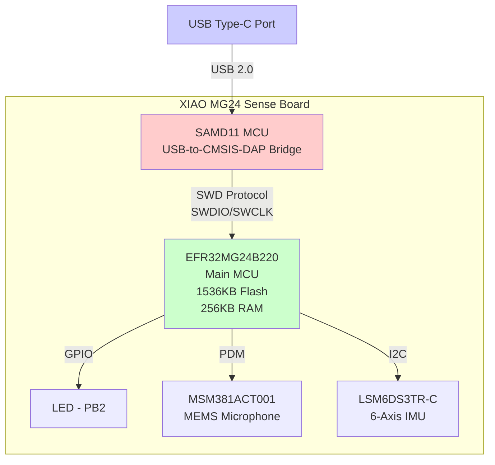
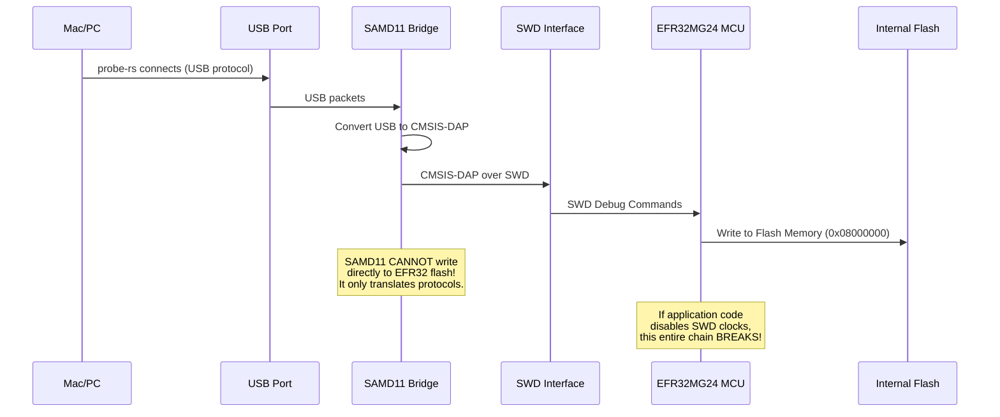
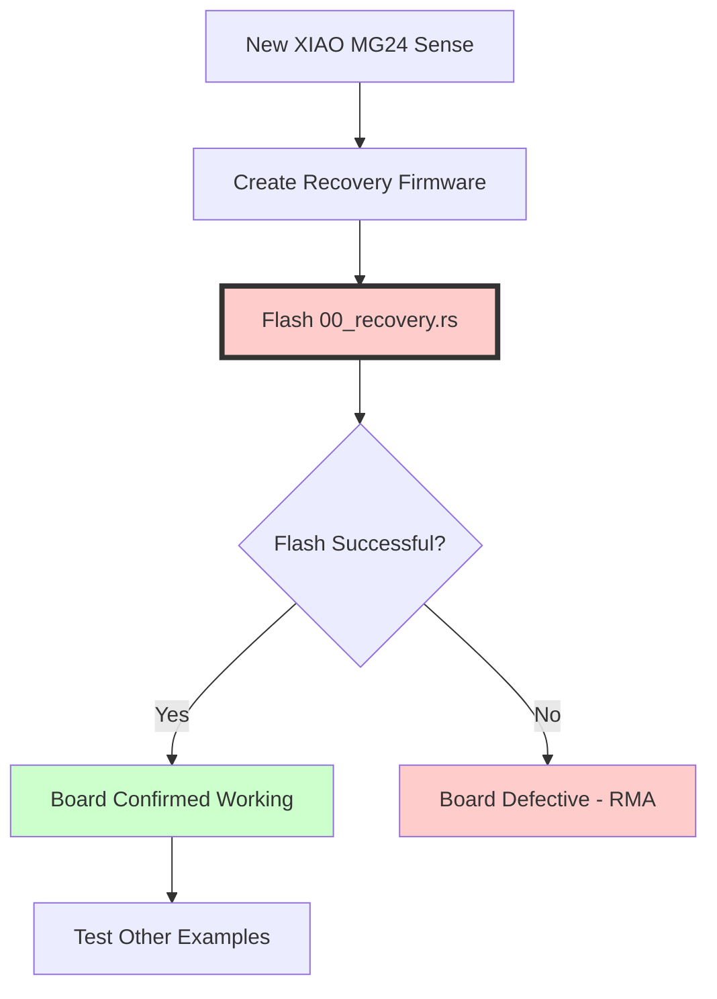

# SAMD11 Bridge Architecture and Safe Flashing Guide

**Date**: December 26, 2025
**Board**: Seeed Studio XIAO MG24 Sense (EFR32MG24B220F1536IM48-B)
**Status**: Critical Safety Documentation
**Purpose**: Prevent device bricking through proper understanding of flash architecture

---

## Executive Summary

The XIAO MG24 Sense has a fundamentally different architecture from other XIAO boards. Understanding the SAMD11 bridge chip and its limitations is CRITICAL to prevent permanent device bricking.

**⚠️ CRITICAL WARNINGS**:

1. **DO NOT flash .elf files directly** - May brick the device permanently
2. **The SAMD11 is NOT a bootloader** - It's only a USB-to-SWD bridge
3. **There is NO USB DFU mode** - Unlike XIAO nRF52840 and SAMD21
4. **PC0/PC1 escape pin is your last resort** - Hardware modification required

---

## Table of Contents

1. [Architecture Overview](#architecture-overview)
2. [SAMD11 Bridge Chip Explained](#samd11-bridge-chip-explained)
3. [Critical Differences from Other XIAO Boards](#critical-differences-from-other-xiao-boards)
4. [Safe Flashing Procedures](#safe-flashing-procedures)
5. [File Format Requirements](#file-format-requirements)
6. [What Can Brick Your Device](#what-can-brick-your-device)
7. [Escape Pin Recovery (PC0 vs PC1)](#escape-pin-recovery-pc0-vs-pc1)
8. [Recommended Workflow](#recommended-workflow)

---

## Architecture Overview

### Complete XIAO MG24 Sense Architecture



### Data Flow During Flashing



---

## SAMD11 Bridge Chip Explained

### What the SAMD11 Actually Does

The SAMD11 is a **protocol converter**, NOT a bootloader or programmer.

**Functions**:
```
┌──────────────────────────────────────────────────┐
│  SAMD11 Microcontroller (Bridge Chip)            │
│                                                   │
│  Input:  USB 2.0 packets from computer           │
│           ↓                                       │
│  Process: CMSIS-DAP v2.0.0 protocol conversion   │
│           ↓                                       │
│  Output:  SWD signals (SWDIO/SWCLK)              │
│                                                   │
│  Capabilities:                                    │
│  ✅ USB to SWD protocol conversion               │
│  ✅ Provides USB serial port (CDC)               │
│  ✅ Exposes CMSIS-DAP debug interface            │
│                                                   │
│  Limitations:                                     │
│  ❌ Cannot write directly to EFR32MG24 flash     │
│  ❌ Cannot bypass SWD interface                  │
│  ❌ Cannot recover if SWD is disabled            │
│  ❌ No DFU (Device Firmware Update) mode         │
│  ❌ No UF2 bootloader                            │
│  ❌ No mass storage mode                         │
└──────────────────────────────────────────────────┘
```

### USB Device Information

When connected, the SAMD11 bridge presents itself as:

```bash
# macOS
$ system_profiler SPUSBDataType | grep -A 10 "XIAO MG24"

Product ID: 0x0062
Vendor ID: 0x2886 (Seeed Studio)
Serial Number: 24D15EE4
Speed: Up to 12 Mb/s
Location ID: 0x...
Current Available (mA): 500
Current Required (mA): 100
Extra Operating Current (mA): 0
```

**Device Path**: `/dev/cu.usbmodem24D15EE43` (serial port)
**CMSIS-DAP Version**: v2.0.0

### What the SAMD11 CANNOT Do

**CRITICAL**: The SAMD11 is NOT like the bootloader on XIAO nRF52840 or SAMD21.

| Feature | XIAO nRF52840 | XIAO SAMD21 | **XIAO MG24** |
|---------|---------------|-------------|---------------|
| USB Bootloader | ✅ UF2 | ✅ UF2 | ❌ **NONE** |
| Drag-and-Drop Flash | ✅ Yes | ✅ Yes | ❌ **NO** |
| Double-Tap Reset Recovery | ✅ Yes | ✅ Yes | ❌ **NO** |
| USB DFU Mode | ✅ Yes | ✅ Yes | ❌ **NO** |
| Flash Method | UF2 file | UF2 file | **SWD ONLY** |
| Recovery if Bricked | Easy | Easy | **DIFFICULT** |

---

## Critical Differences from Other XIAO Boards

### Comparison Table

| Aspect | Other XIAO Boards | **XIAO MG24 Sense** |
|--------|-------------------|---------------------|
| **Bootloader** | Dedicated bootloader partition | ❌ No bootloader |
| **Flash Start** | Offset (e.g., 0x00026000) | 0x08000000 (direct) |
| **Recovery Mode** | Double-tap reset button | ⚠️ PC0/PC1 escape pin only |
| **Flash Tool** | Drag-and-drop .uf2 file | SWD debugger (probe-rs) |
| **Bricking Risk** | Very Low | **VERY HIGH** |
| **Factory Restore** | Download .uf2 from Seeed | ❌ **IMPOSSIBLE** |

### Why XIAO MG24 is Different

1. **No Bootloader Partition**:
   ```
   Other XIAO:                  XIAO MG24:
   ┌─────────────────┐          ┌─────────────────┐
   │  Bootloader     │ 0x00000  │  Application    │ 0x08000000
   ├─────────────────┤          │  (Full Flash)   │
   │  Application    │ 0x26000  │                 │
   ├─────────────────┤          │                 │
   │  User Data      │          │                 │
   └─────────────────┘          └─────────────────┘ 0x08180000

   Bootloader can recover        No safety net!
   even if app is corrupted      App corruption = brick
   ```

2. **No USB Mass Storage**:
   - Other XIAO boards enumerate as USB mass storage device
   - You can drag .uf2 files to the "drive"
   - XIAO MG24: Only CMSIS-DAP interface, no mass storage mode

3. **No Reset Button Recovery**:
   - Other XIAO: Double-tap reset → bootloader mode
   - XIAO MG24: Reset button only resets, doesn't enter recovery

---

## Safe Flashing Procedures

### Recommended Tool: probe-rs (Rust Native)

**Why probe-rs**:
- ✅ Pure Rust toolchain (project requirement)
- ✅ Native CMSIS-DAP support
- ✅ EFR32MG24 support (added in PR #3443)
- ✅ Integrated with cargo
- ✅ Fast and reliable

**Configuration** (`efr32mg24-hal/.cargo/config.toml`):

```toml
[build]
target = "thumbv8m.main-none-eabihf"

[target.thumbv8m.main-none-eabihf]
runner = "probe-rs run --chip EFR32MG24B220F1536IM48"
```

### Safe Flashing Command

```bash
# ALWAYS use this command during development:
cargo run --example XX_name --features rt --release

# What happens:
# 1. Cargo builds Rust code → .elf file
# 2. probe-rs extracts loadable sections
# 3. probe-rs converts to internal format (NOT .elf!)
# 4. probe-rs connects via CMSIS-DAP
# 5. SAMD11 converts USB to SWD
# 6. SWD writes to EFR32MG24 flash
# 7. probe-rs verifies write
# 8. probe-rs resets MCU
```

### What probe-rs Actually Flashes

**IMPORTANT**: probe-rs does NOT flash raw .elf files!

```rust
// probe-rs internal process:
fn flash_elf(elf_path: &str) -> Result<()> {
    // 1. Parse ELF file
    let elf = parse_elf(elf_path)?;

    // 2. Extract ONLY loadable sections
    let sections = elf.program_headers()
        .filter(|p| p.p_type == PT_LOAD)  // Only PT_LOAD segments
        .map(|p| {
            FlashSection {
                address: p.p_paddr,        // Physical address
                data: p.data,              // Raw binary data
            }
        });

    // 3. Write each section to flash
    for section in sections {
        session.write_32(section.address, &section.data)?;
    }

    // 4. Verify
    verify_flash()?;

    // NO .elf metadata is written to flash!
    // ONLY the raw binary data from PT_LOAD segments!
}
```

---

## File Format Requirements

### ⚠️ CRITICAL WARNING: Do NOT Flash Raw .elf Files

From official Seeed Studio documentation:

> **XIAO MG24 prohibits flashing .elf files**, as doing so may brick the device.

**What This Means**:

| Method | File Type | Result |
|--------|-----------|--------|
| `cargo run --example XX` | .elf (via probe-rs) | ✅ **SAFE** (probe-rs extracts binary) |
| `probe-rs download firmware.elf` | .elf (via probe-rs) | ✅ **SAFE** (probe-rs extracts binary) |
| Direct .elf flash (raw copy) | .elf (raw) | ❌ **BRICKS DEVICE** |
| OpenOCD with .elf | .elf (OpenOCD parses) | ✅ **SAFE** (OpenOCD extracts binary) |
| `commander flash firmware.elf` | .elf (Commander parses) | ✅ **SAFE** (Commander extracts binary) |

**Why Raw .elf Flashing Bricks the Device**:

1. .elf files contain metadata (symbols, debug info, headers)
2. If written raw to flash, metadata corrupts interrupt vector table
3. CPU reads invalid reset vector at 0x08000004
4. CPU crashes or enters undefined state
5. May disable SWD interface before debug can reconnect
6. **Result**: Permanent brick (software recovery impossible)

### Correct Binary Formats

**Supported Formats** (tools automatically extract):

```
Format       Tool           Description
───────────────────────────────────────────────────────
.elf         probe-rs       ELF executable (tool extracts PT_LOAD)
.elf         OpenOCD        ELF executable (tool extracts sections)
.hex         probe-rs       Intel HEX format (ASCII)
.bin         probe-rs       Raw binary (no metadata)
.s37         Commander      Motorola S-record
```

**Recommended**: Always use `cargo run` or `probe-rs download` - they handle .elf correctly.

---

## What Can Brick Your Device

### Bricking Scenarios (From Experience and Research)

#### 1. Clock Configuration Disables SWD (YOUR CASE)

**What Happened**:
```rust
// In 01_clock.rs (DANGEROUS code that bricked the board)
let (clocks, cmu) = Clocks::new(
    dp.cmu_s,
    ClockConfig {
        hfxo: Some(HfxoConfig::new(39_000_000)),
        lfxo: Some(Default::default()),
    },
).expect("Clock configuration failed");

let frozen_clocks = clocks.freeze(cmu);
// ↑ This disabled SWD debug clocks!
```

**Why It Bricks**:
1. Application starts, configures clocks
2. SWD debug clock (HFXO) disabled or switched to incompatible source
3. Debug port becomes unresponsive
4. Cannot reflash via SWD (SWD requires clocks!)
5. **Brick**: Software recovery impossible

**Prevention**:
```rust
#[entry]
fn main() -> ! {
    let dp = pac::Peripherals::take().unwrap();

    // CRITICAL: Preserve debug clocks in debug builds
    #[cfg(debug_assertions)]
    unsafe {
        // Keep HFXO enabled for debug
        dp.CMU_S.clken0().modify(|_, w| w.hfxo0().set_bit());

        // Keep SWD enabled - PREVENTS BRICKING
        dp.CMU_S.clken1().modify(|_, w| w.swd().set_bit());
    }

    // Now safe to configure other clocks
    // ...
}
```

#### 2. DeepSleep Mode Without Escape Pin

**What Happens**:
```rust
// DANGEROUS: DeepSleep without user switch check
fn enter_deep_sleep() {
    // Enter EM4 (Energy Mode 4) - deepest sleep
    dp.EMU_S.ctrl().modify(|_, w| w.em4ctrl().set());
    cortex_m::asm::wfi();  // Wait for interrupt

    // Device may not wake up correctly
    // SWD interface disabled in deep sleep
    // Cannot reflash!
}
```

**Prevention** (from Seeed documentation):
```rust
#define USER_SW  PC3  // User switch pin

fn main() {
    // Check if user is holding button (escape mechanism)
    if (digitalRead(USER_SW) == LOW) {
        // Enter infinite loop instead of deep sleep
        // Allows sketch upload
        while (true) {
            // Board remains flashable
        }
    }

    // Normal operation
    // ...
}
```

#### 3. Flash Memory in Sleep Mode

**Warning from Seeed**:
> "Ensure that your sketch does not put the flash memory into sleep mode...unless absolutely necessary."

**Why It's Dangerous**:
- Flash sleep mode disables read access
- Debug interface cannot read flash for verification
- May prevent SWD from writing new firmware
- Recovery requires waking flash first (but app code may not allow it)

#### 4. Write Protection Enabled

**Scenario**: Accidentally set flash write protection bits

```rust
// DANGEROUS: Setting write protection without knowing how to clear it
unsafe {
    let msc = &(*pac::MSC_S::ptr());
    msc.writectrl().write(|w| w.wren().clear_bit());  // Disable writes
    msc.lock().write(|w| w.bits(0x00000001));         // Lock flash

    // Now flash is permanently locked until mass erase!
}
```

**Recovery**: Requires mass erase (erases ALL flash, including app)

---

## Escape Pin Recovery (PC0 vs PC1)

### Pin Confusion in Documentation

**CONFLICTING INFORMATION FOUND**:

| Source | Pin | Description |
|--------|-----|-------------|
| Seeed Wiki (Getting Started) | **PC1** | "If PC1 is pulled LOW during reset" |
| Seeed Forum (DeepSleep) | **PC0** | "PC0 has built-in escape function" |
| Both Sources | PC3 | User switch (not escape pin) |

**CONCLUSION**: Test BOTH PC0 and PC1 during recovery!

### PC0 Recovery Method (From Forum)

**Source**: [Seeed Forum - DeepSleep Bricks XIAO MG24](https://forum.seeedstudio.com/t/deepsleep-bricks-xiao-mg24/284889)

**Procedure**:
```
1. Disconnect USB
2. Connect PC0 to GND (ground)
3. Reset device twice (power cycle or press reset button 2x)
4. Board enters recovery mode
5. Flash new firmware immediately
6. Disconnect PC0 from GND
7. Reset device
```

### PC1 Recovery Method (From Wiki)

**Source**: [Seeed Wiki - XIAO MG24 Getting Started](https://wiki.seeedstudio.com/xiao_mg24_getting_started/)

**Procedure**:
```
1. Disconnect USB
2. Connect PC1 to GND
3. Reconnect USB (or power cycle)
4. Device enters infinite loop
5. Debug port remains accessible
6. Flash recovery firmware via SWD
7. Disconnect PC1 from GND
8. Reset device
```

### Which Pin to Use?

**Recommendation**: Try PC0 first (easier, mentioned in recent forum posts), then PC1 if that fails.

**Pin Locations** (from EFR32MG24 datasheet):

| Pin Name | Chip Pin # | XIAO Board | Accessibility |
|----------|------------|------------|---------------|
| PC0 | 36 (QFN48) | Unknown | May be test pad |
| PC1 | 37 (QFN48) | Unknown | May be test pad |
| PC3 | 39 (QFN48) | User Switch | ✅ Accessible |
| GND | Multiple | Edge pads | ✅ Accessible |

**TODO**: Obtain XIAO MG24 Sense schematic to locate PC0/PC1 pads.

---

## Recommended Workflow

### For New Boards (FIRST FLASH)



**Steps**:

```bash
# Step 1: Create minimal recovery firmware
# File: efr32mg24-hal/examples/00_recovery.rs
# (See code example below)

# Step 2: Flash recovery firmware FIRST
cd efr32mg24-hal
cargo run --example 00_recovery --features rt --release

# Step 3: Verify it works
probe-rs list  # Should detect board

# Step 4: Power cycle and verify again
# Unplug USB, reconnect, run probe-rs list again

# Step 5: Only NOW test other examples
cargo run --example 01_clock --features rt --release  # Now safe!
```

### For Development (EVERY DAY)

```bash
# ALWAYS use debug builds during development
cargo run --example XX_name --features rt  # NOT --release!

# Debug builds keep #[cfg(debug_assertions)] active
# This preserves SWD debug access automatically
```

### For Production (FINAL RELEASE ONLY)

```bash
# Only use --release for final, tested code
cargo run --example XX_name --features rt --release

# BEFORE RELEASING:
# 1. Test in debug mode first
# 2. Verify debug preservation works
# 3. Test on disposable board
# 4. Only then flash production board
```

### Recovery Firmware Template

Create `efr32mg24-hal/examples/00_recovery.rs`:

```rust
//! Minimal Recovery Firmware for XIAO MG24 Sense
//!
//! This firmware does NOTHING except preserve debug access.
//! Flash this FIRST on any new board before testing risky code.
//!
//! Features:
//! - Preserves SWD debug clocks (ALWAYS, not just in debug builds)
//! - Minimal clock configuration (safe defaults)
//! - Infinite loop (board remains flashable)
//! - No peripherals initialized (minimal risk)

#![no_std]
#![no_main]

use cortex_m_rt::entry;
use efr32mg24_hal::pac;
use panic_halt as _;

#[entry]
fn main() -> ! {
    let dp = pac::Peripherals::take().unwrap();

    // CRITICAL SAFETY: Preserve debug access FOREVER
    // NOTE: This is NOT #[cfg(debug_assertions)]!
    // Debug must ALWAYS be preserved in recovery firmware.
    unsafe {
        // Keep HFXO enabled for debug
        dp.CMU_S.clken0().modify(|_, w| w.hfxo0().set_bit());

        // Keep SWD enabled - PREVENTS BRICKING
        dp.CMU_S.clken1().modify(|_, w| w.swd().set_bit());
    }

    // Infinite loop - board is safe and recoverable
    // You can flash new firmware at any time
    loop {
        cortex_m::asm::nop();
    }
}
```

---

## Summary: Golden Rules

### ✅ DO

1. ✅ **ALWAYS flash 00_recovery.rs FIRST** on new boards
2. ✅ **Use probe-rs** for all flashing (correct .elf handling)
3. ✅ **Test in debug mode** first (`cargo run` without `--release`)
4. ✅ **Preserve debug clocks** in ALL examples
5. ✅ **Use separate test board** for risky experiments
6. ✅ **Keep schematic handy** for PC0/PC1 location

### ❌ DON'T

1. ❌ **NEVER flash raw .elf files** directly to memory
2. ❌ **NEVER disable SWD clocks** during development
3. ❌ **NEVER test clock code** on your only board
4. ❌ **NEVER enter DeepSleep** without escape pin check
5. ❌ **NEVER use `--release`** until code is fully tested
6. ❌ **NEVER assume XIAO MG24** works like other XIAO boards

---

## References and Sources

### Official Seeed Documentation

1. [Getting Started with Seeed Studio XIAO MG24(Sense)](https://wiki.seeedstudio.com/xiao_mg24_getting_started/)
2. [DeepSleep bricks XIAO_MG24 - Forum Discussion](https://forum.seeedstudio.com/t/deepsleep-bricks-xiao-mg24/284889)
3. [Getting Started Discussion - GitHub](https://github.com/Seeed-Studio/wiki-documents/discussions/2030)

### XIAO MG24 Technical

4. [XIAO MG24 — Zephyr Project Documentation](https://docs.zephyrproject.org/latest/boards/seeed/xiao_mg24/doc/index.html)
5. [boards: seeed: Add XIAO MG24 board - Zephyr PR](https://github.com/zephyrproject-rtos/zephyr/pull/88321)

### Silicon Labs Documentation

6. [AN1190: Series 2 Secure Debug](https://www.silabs.com/documents/public/application-notes/an1190-efr32-secure-debug.pdf)
7. [EFR32MG24 Wireless SoC Family Data Sheet](https://www.silabs.com/documents/public/data-sheets/efr32mg24-datasheet.pdf)

### Community Resources

8. [XIAO BLE (Sense) bootloader bricked recovery](https://forum.seeedstudio.com/t/xiao-ble-sense-bootloader-bricked-how-to-restore-it/263091)
9. [Unbricking a Seeed Xiao Samd21 - Kevin's Blog](https://emalliab.wordpress.com/2023/03/12/unbricking-a-seeed-xiao-samd21/)

---

**Document Version**: 1.0
**Last Updated**: December 26, 2025
**Status**: Critical Safety Documentation
**Author**: EFR32MG24 HAL Development Team

**IMPORTANT**: Read this document BEFORE flashing ANY code to XIAO MG24 boards.
