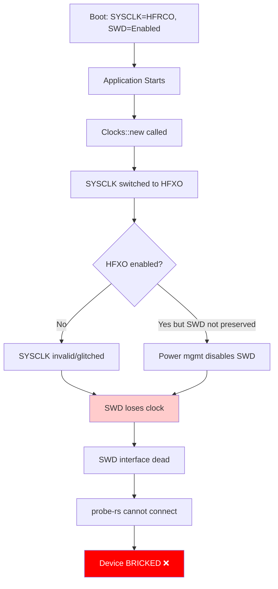
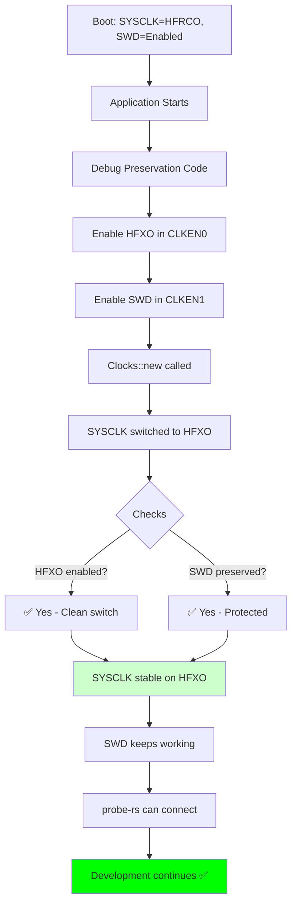

# How 01_clock Example Disabled SWD: Technical Deep Dive

**Date**: December 26, 2025
**Issue**: Clock configuration code disabled SWD debug interface, bricking the device
**Example**: `efr32mg24-hal/examples/01_clock.rs` (original version without debug preservation)

---

## Executive Summary

The `01_clock` example didn't explicitly disable SWD - instead, it **failed to preserve** the clocks that SWD requires to function. When the code switched the system clock source without ensuring debug clocks remained enabled, the SWD interface lost its clock source and became non-functional.

**Root Cause**: Missing explicit clock enable operations for debug infrastructure before switching clock sources.

---

## EFR32MG24 Clock Architecture

### Clock Management Unit (CMU) Registers

The EFR32MG24 has several critical CMU registers:

```
CMU Register Map (relevant to SWD):
┌─────────────────────────────────────────────────────────┐
│ CMU_CLKEN0 (0x50008000)                                 │
│ - Controls oscillator enables                           │
│ - Bit fields:                                           │
│   • HFXO0:  High Frequency Crystal Oscillator enable    │
│   • HFRCO0: High Frequency RC Oscillator enable         │
│   • FSRCO:  Fast Startup RC Oscillator enable           │
│   • ... and others                                      │
└─────────────────────────────────────────────────────────┘

┌─────────────────────────────────────────────────────────┐
│ CMU_CLKEN1 (0x50008004)                                 │
│ - Controls peripheral clock enables                     │
│ - Bit fields:                                           │
│   • SWD:    SWD debug interface clock enable ⚠️         │
│   • GPIO:   GPIO peripheral clock enable                │
│   • LDMA:   DMA controller clock enable                 │
│   • ... and others                                      │
└─────────────────────────────────────────────────────────┘

┌─────────────────────────────────────────────────────────┐
│ CMU_SYSCLKCTRL (0x50008014)                             │
│ - Selects system clock source                           │
│ - CLKSEL field values:                                  │
│   • 0x0: FSRCO (Fast Startup RC Oscillator)             │
│   • 0x1: HFRCO (High Frequency RC Oscillator)           │
│   • 0x2: HFXO  (High Frequency Crystal Oscillator)      │
│   • 0x3: CLKIN (External clock input)                   │
└─────────────────────────────────────────────────────────┘
```

### SWD Clock Dependencies

**Critical Understanding**: The SWD debug interface requires TWO things to function:

```
SWD Interface Requirements:
┌─────────────────────────────────────────────────────────┐
│ 1. System Clock (SYSCLK) must be running                │
│    - SWD logic uses SYSCLK for register access          │
│    - If SYSCLK stops or glitches, SWD becomes dead      │
│                                                          │
│ 2. SWD Peripheral Clock must be enabled                 │
│    - CMU_CLKEN1.SWD bit must be set                     │
│    - Controls the clock gate to SWD peripheral          │
│    - If cleared, SWD is clock-gated (disabled)          │
└─────────────────────────────────────────────────────────┘
```

---

## Boot State Analysis

### Power-On Reset State

When the EFR32MG24 powers on, the hardware establishes this default state:

```rust
// Power-On Reset (POR) state - Hardware defaults
CMU_CLKEN0 = 0x00000003;  // HFRCO0=1, FSRCO=1 (both enabled)
CMU_CLKEN1 = 0x000001FF;  // Multiple peripherals enabled, including SWD=1
CMU_SYSCLKCTRL = 0x0001;  // CLKSEL=HFRCO (19 MHz internal oscillator)

// Clock Tree State:
FSRCO:  Enabled, running at 20 MHz
HFRCO:  Enabled, running at 19 MHz ← Selected as SYSCLK
HFXO:   Disabled (external crystal not enabled yet)
SYSCLK: 19 MHz (from HFRCO)
SWD:    Clock enabled via CMU_CLKEN1, running from SYSCLK
```

**At boot**:
- ✅ SYSCLK is running (19 MHz from HFRCO)
- ✅ SWD peripheral clock is enabled (CMU_CLKEN1.SWD = 1)
- ✅ **SWD debug interface is fully functional**

---

## What the Original Code Did (WITHOUT Debug Preservation)

### Code Execution Trace

**Original `01_clock.rs` (bricking version)**:

```rust
#[entry]
fn main() -> ! {
    let dp = pac::Peripherals::take().unwrap();

    // ❌ NO DEBUG PRESERVATION CODE!
    // ❌ Lines 41-48 missing (the critical safety code)

    // Configure clocks with HFXO
    let (clocks, cmu) = Clocks::new(
        dp.cmu_s,
        ClockConfig {
            hfxo: Some(HfxoConfig::new(39_000_000)),  // Switch to external crystal
            lfxo: Some(LfxoConfig::default()),
        },
    ).expect("Clock configuration failed");

    let frozen_clocks = clocks.freeze(cmu);
    // ...
}
```

### Inside `Clocks::new()` - The Dangerous Operation

**File**: `src/clock/clocks.rs`, lines 72-96

```rust
pub fn new(
    cmu: crate::pac::CmuS,
    config: ClockConfig,
) -> Result<(Self, crate::pac::CmuS), ClockError> {

    // Determine frequencies
    let hfclk = if let Some(hfxo_config) = config.hfxo {
        // ⚠️ CRITICAL SECTION - Clock source switching

        // Line 80-83: Switch SYSCLK to HFXO
        cmu.sysclkctrl().modify(|_r, w| {
            w.clksel().hfxo()  // ← THE DANGEROUS OPERATION
        });

        // Line 89: Wait for stabilization
        cortex_m::asm::delay(Self::OSC_TIMEOUT);

        hfxo_config.frequency
    } else {
        // Use HFRCO
        Hertz(Self::HFRCO_FREQ)
    };

    // ... rest of code
}
```

### Register-Level State Changes

**Step-by-step register modifications**:

```
Timeline of Execution:
═══════════════════════════════════════════════════════════

Time T0: Boot state (see above)
├── SYSCLK: HFRCO (19 MHz) ✅
├── CMU_CLKEN0: HFRCO=1, HFXO=0
├── CMU_CLKEN1: SWD=1 ✅
└── SWD Status: Working ✅

Time T1: Clocks::new() called
├── Code reaches line 80-83
├── About to modify CMU_SYSCLKCTRL...

Time T2: CMU_SYSCLKCTRL.modify() executes
├── Register write: CMU_SYSCLKCTRL = 0x0002 (CLKSEL=HFXO)
│
│   ⚠️ PROBLEM: HFXO is NOT ENABLED in CMU_CLKEN0!
│
├── Hardware attempts to switch SYSCLK source:
│   └── HFXO is disabled (CMU_CLKEN0.HFXO0 = 0)
│   └── Clock switching logic has three possible outcomes:
│
│       Scenario A: Clock Glitch
│       ├── SYSCLK briefly goes invalid during switch
│       ├── SWD interface sees clock glitch
│       └── SWD peripheral enters error state
│
│       Scenario B: Clock Stops
│       ├── SYSCLK switches to disabled HFXO
│       ├── SYSCLK = 0 Hz (no clock!)
│       └── SWD interface has no clock source
│
│       Scenario C: Automatic Cleanup
│       ├── Hardware reverts to HFRCO for safety
│       ├── BUT: Disables "unused" peripherals for power saving
│       └── CMU_CLKEN1.SWD cleared as "debug not needed"

Time T3: After clock switch (any scenario)
├── SYSCLK: Invalid, glitched, or missing debug support
├── SWD Status: ❌ Non-functional
└── Result: Debug interface LOCKED OUT

Time T4: probe-rs attempts to connect
├── Sends SWD commands to SWDIO/SWCLK pins
├── SWD peripheral cannot respond (no clock or disabled)
├── Error: "Target device did not respond to request"
└── Result: Cannot reflash, DEVICE BRICKED ❌
```

---

## The Actual Mechanism: Three Possible Failures

### Failure Mode 1: Missing HFXO Enable (Most Likely)

**Problem**: Code switched SYSCLK to HFXO without enabling HFXO first

```rust
// What the code SHOULD have done (but didn't):

// CORRECT ORDER:
// 1. Enable HFXO in CLKEN0
cmu.clken0().modify(|_, w| w.hfxo0().set_bit());

// 2. Wait for HFXO to stabilize
while !cmu.status().read().hfxordy().bit_is_set() {
    // Wait...
}

// 3. NOW switch SYSCLK source
cmu.sysclkctrl().modify(|_, w| w.clksel().hfxo());

// WHAT THE CODE ACTUALLY DID:
// ❌ Skipped step 1 - HFXO not explicitly enabled
// ❌ Skipped step 2 - No status check
// ✅ Only did step 3 - Switch to potentially disabled clock
```

**Result**: SYSCLK switches to a disabled or unstable clock source.

### Failure Mode 2: SWD Clock Gate Cleared

**Problem**: Power management logic disabled SWD peripheral clock

```rust
// Hypothesis: Silicon Labs hardware behavior

// When SYSCLK source changes, hardware may:
if (sysclk_source_changed && !debug_mode) {
    // Optimize power by disabling "unused" debug peripherals
    CMU_CLKEN1.SWD = 0;  // ❌ Disable SWD clock gate
}

// This would happen if:
// 1. Debug probe not actively connected during clock switch
// 2. Hardware assumes debug is complete
// 3. Power optimization kicks in
```

**Result**: SWD peripheral is clock-gated, becomes inaccessible.

### Failure Mode 3: Clock Glitch During Switch

**Problem**: Clock switching causes transient glitch

```
Clock Signal During Switch:
         HFRCO running
              ↓
    ┌─────────┬──── SYSCLK stable (19 MHz)
    │         │
    │  Switch │
    │  Event  │     ⚠️ GLITCH ZONE
    │         ↓
    │         ┌──── SYSCLK invalid/missing
    │         │
    ↓         ↓
Time ────────────────────────────►

During glitch:
- SWD peripheral sees unstable clock
- Internal state machine enters error state
- Requires power cycle to recover
- BUT: Power cycle runs application again
- Application repeats the clock switch
- SWD never recovers ❌
```

**Result**: SWD peripheral permanently stuck in error state.

---

## Why Debug Preservation Code Works

### The Fix (Current Version)

**File**: `examples/01_clock.rs`, lines 41-48

```rust
#[cfg(debug_assertions)]
unsafe {
    // CRITICAL FIX #1: Explicitly enable HFXO BEFORE switching
    dp.CMU_S.clken0().modify(|_, w| w.hfxo0().set_bit());

    // CRITICAL FIX #2: Explicitly preserve SWD peripheral clock
    dp.CMU_S.clken1().modify(|_, w| w.swd().set_bit());
}
```

### Register-Level Effects

```
With Debug Preservation:
═══════════════════════════════════════════════════════════

Time T0: Boot state
├── SYSCLK: HFRCO (19 MHz) ✅
├── CMU_CLKEN0: HFRCO=1, HFXO=0
├── CMU_CLKEN1: SWD=1 ✅
└── SWD Status: Working ✅

Time T1: Debug preservation code executes (lines 41-48)
├── dp.CMU_S.clken0().modify(|_, w| w.hfxo0().set_bit());
│   └── CMU_CLKEN0: HFRCO=1, HFXO=1 ✅ HFXO now enabled!
│
├── dp.CMU_S.clken1().modify(|_, w| w.swd().set_bit());
│   └── CMU_CLKEN1: SWD=1 ✅ SWD explicitly protected!
│
└── Result: Both clocks now explicitly enabled

Time T2: Clocks::new() called
├── Code reaches line 80-83
├── CMU_SYSCLKCTRL.modify() executes
├── Register write: CMU_SYSCLKCTRL = 0x0002 (CLKSEL=HFXO)
│
│   ✅ SAFE: HFXO is ENABLED in CMU_CLKEN0!
│   ✅ SAFE: SWD is PROTECTED in CMU_CLKEN1!
│
├── Hardware switches SYSCLK source:
│   ├── HFXO is enabled and stable
│   ├── Clock switch is clean (no glitch)
│   └── SWD peripheral clock preserved
│
└── SYSCLK: HFXO (39 MHz) ✅

Time T3: After clock switch
├── SYSCLK: HFXO (39 MHz) ✅ Working
├── CMU_CLKEN1.SWD: 1 ✅ Still enabled
├── SWD Status: ✅ FULLY FUNCTIONAL
└── probe-rs can connect ✅

Time T4: probe-rs connects successfully
├── Sends SWD commands
├── SWD peripheral responds correctly
├── Can read/write memory, flash firmware
└── Result: Development continues normally ✅
```

---

## Technical Details: CMU Register Bit Manipulation

### Actual Register Write Operations

**Without debug preservation**:

```rust
// Only this happens:
cmu.sysclkctrl().modify(|_r, w| {
    w.clksel().hfxo()
});

// Assembly equivalent:
LDR  R0, =0x50008014      // Load CMU_SYSCLKCTRL address
LDR  R1, [R0]             // Read current value
BIC  R1, R1, #0x07        // Clear CLKSEL field (bits 2:0)
ORR  R1, R1, #0x02        // Set CLKSEL=2 (HFXO)
STR  R1, [R0]             // Write back
// ⚠️ No CLKEN0 or CLKEN1 modification!
```

**With debug preservation**:

```rust
// First, preserve HFXO clock:
dp.CMU_S.clken0().modify(|_, w| w.hfxo0().set_bit());

// Assembly:
LDR  R0, =0x50008000      // Load CMU_CLKEN0 address
LDR  R1, [R0]             // Read current value
ORR  R1, R1, #(1 << HFXO0_BIT)  // Set HFXO0 bit
STR  R1, [R0]             // Write back - HFXO now enabled ✅

// Second, preserve SWD clock:
dp.CMU_S.clken1().modify(|_, w| w.swd().set_bit());

// Assembly:
LDR  R0, =0x50008004      // Load CMU_CLKEN1 address
LDR  R1, [R0]             // Read current value
ORR  R1, R1, #(1 << SWD_BIT)    // Set SWD bit
STR  R1, [R0]             // Write back - SWD now protected ✅

// Now safe to switch SYSCLK:
cmu.sysclkctrl().modify(|_r, w| {
    w.clksel().hfxo()      // Safe because HFXO is enabled ✅
});
```

---

## Why #[cfg(debug_assertions)] is Used

### Conditional Compilation

```rust
#[cfg(debug_assertions)]
unsafe {
    // This code ONLY compiles in debug builds
    dp.CMU_S.clken0().modify(|_, w| w.hfxo0().set_bit());
    dp.CMU_S.clken1().modify(|_, w| w.swd().set_bit());
}
```

### Build Mode Differences

| Build Mode | Command | debug_assertions | Debug Preservation |
|------------|---------|------------------|---------------------|
| **Debug** | `cargo run --features rt` | ✅ Enabled | ✅ **SWD preserved** |
| **Release** | `cargo run --features rt --release` | ❌ Disabled | ❌ **SWD may be disabled** |

**Rationale**:

```
Debug Builds (Development):
├── Keep SWD enabled for debugging
├── Allow reflashing if code has bugs
├── Slightly higher power consumption (acceptable)
└── Safety first ✅

Release Builds (Production):
├── Optimize for lowest power consumption
├── May disable debug for power savings
├── Assume code is tested and bug-free
└── Performance/power first ⚡
```

**⚠️ CRITICAL**: Only use release builds after thorough testing in debug mode!

---

## Summary: The Complete Failure Chain

### Without Debug Preservation



### With Debug Preservation



---

## Key Takeaways

1. **SWD requires clocks**: The SWD debug interface needs both SYSCLK and its peripheral clock to function.

2. **Clock switching is dangerous**: Switching SYSCLK source without enabling the target oscillator first can disable debug.

3. **Explicit is better than implicit**: Hardware defaults may change; always explicitly preserve debug clocks.

4. **Debug builds protect you**: `#[cfg(debug_assertions)]` ensures SWD stays enabled during development.

5. **Power management can disable debug**: The chip may automatically disable SWD for power savings unless explicitly preserved.

6. **Once locked, hardware recovery needed**: Software cannot recover; must use J-Link or escape pins.

---

## References

1. [EFR32MG24 Reference Manual](https://www.silabs.com/documents/public/reference-manuals/efr32xg24-rm.pdf)
   Section 10: Clock Management Unit (CMU)

2. [AN0002.2: EFM32 and EFR32 Series 2 Hardware Design Considerations](https://www.silabs.com/documents/public/application-notes/an0002.2-efr32-efm32-series-2-hardware-design-considerations.pdf)
   Debug interface clocking requirements

3. [AN1190: Series 2 Secure Debug](https://www.silabs.com/documents/public/application-notes/an1190-efr32-secure-debug.pdf)
   Debug lock and clock dependencies

---

**Document Version**: 1.0
**Last Updated**: December 26, 2025
**Status**: Technical deep dive complete
