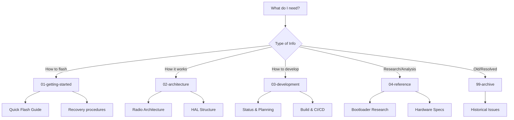

# EFR32MG24 Project Documentation Index

Complete documentation index for the EFR32MG24 embedded Rust project.

## Quick Navigation

- **New to the project?** Start with [Getting Started](01-getting-started/README.md)
- **Need to flash firmware?** See [Quick Flash Guide](01-getting-started/QUICK_FLASH_GUIDE.md)
- **Building firmware?** Check [Scripts Documentation](../scripts/README.md)
- **Architecture details?** Read [Architecture Overview](02-architecture/README.md)
- **Development workflow?** Check [Development Guide](03-development/README.md)
- **API reference?** See [Reference Documentation](04-reference/README.md)
- **Troubleshooting?** Consult [Recovery Guide](01-getting-started/RECOVERY_GUIDE.md)

## Documentation Structure

This documentation follows the SSOT (Single Source of Truth) methodology, organizing information by topic rather than duplicating content.

### 01. Getting Started

Core guides for getting up and running with the EFR32MG24 hardware and firmware.

**Main Guide:**
- [Getting Started README](01-getting-started/README.md) - Start here

**Flashing Procedures:**
- [Build here, flash where the probe is](01-getting-started/FLASHING.md) - The current workflow, the guards, and what is not yet verified
- [Quick Flash Guide](01-getting-started/QUICK_FLASH_GUIDE.md) - Fast reference for common flashing operations
- [Comprehensive Flashing Guide](01-getting-started/COMPREHENSIVE_FLASHING_GUIDE.md) - Complete flashing documentation
- [Commander Flash Procedure](01-getting-started/COMMANDER_FLASH_PROCEDURE.md) - Using Simplicity Commander
- [OpenOCD Flash Procedure](01-getting-started/OPENOCD_FLASH_PROCEDURE.md) - Using OpenOCD
- [Hardware Flashing Guide](01-getting-started/HARDWARE_FLASHING_GUIDE.md) - Hardware-level flashing details

- [Flash read-back backups](01-getting-started/BACKUPS.md) - Bootloader + app region dumped from the chip, with hashes

**Bootloader:**
- [Bootloader Quick Reference](01-getting-started/BOOTLOADER_QUICK_REFERENCE.md) - Essential bootloader information

**Safety and Recovery:**
- [Critical Safety Protocol](01-getting-started/CRITICAL_SAFETY_PROTOCOL.md) - Must read before flashing
- [Recovery Guide](01-getting-started/RECOVERY_GUIDE.md) - Device recovery procedures

**Recovery Procedures:**
- [BMP Recovery Guide](01-getting-started/recovery/BMP_RECOVERY_GUIDE.md) - Black Magic Probe recovery
- [Board Recovery Status](01-getting-started/recovery/BOARD_RECOVERY_STATUS.md) - Recovery status tracking
- [PC1 Recovery Plan](01-getting-started/recovery/PC1_RECOVERY_PLAN.md) - Specific PC1 recovery
- [Memory Analysis](01-getting-started/recovery/memory_analysis.md) - Memory debugging for recovery

### 02. Architecture

System architecture, design decisions, and technical terminology.

**Overview:**
- [Architecture README](02-architecture/README.md) - Architecture overview

**Core Architecture:**
- [Radio Architecture](02-architecture/RADIO_ARCHITECTURE.md) - Radio subsystem design
- [Unified Radio Architecture](02-architecture/UNIFIED_RADIO_ARCHITECTURE.md) - Unified radio interface design
- [Identifier Scheme](02-architecture/IDENTIFIER_SCHEME.md) - Naming and identification conventions
- [Crate organisation research](02-architecture/CRATE-ORGANISATION-RESEARCH.md) - How rp-hal, nrf-hal, stm32f4xx-hal and esp-hal split PAC/HAL/BSP, and what this workspace took from each
- [Terminology](02-architecture/TERMINOLOGY.md) - Project terminology and definitions

**HAL (Hardware Abstraction Layer):**
- [HAL Structure Plan](02-architecture/hal/HAL_STRUCTURE_PLAN.md) - HAL organization and design

### 03. Development

Development guides, workflows, CI/CD, and project planning.

**Overview:**
- [Development README](03-development/README.md) - Development guide overview

**Project Management:**
- [Status](03-development/STATUS.md) - Current project status
- [Plan](03-development/PLAN.md) - Project roadmap and planning
- [Backlog](03-development/BACKLOG.md) - Feature backlog and TODOs
- [Log](03-development/LOG.md) - Development log and decisions

**Development Guides:**
- [BSP Plan](03-development/BSP_PLAN.md) - Board Support Package planning
- [Build Optimization](03-development/BUILD_OPTIMIZATION.md) - Build system optimization
- [Bootloader Session](03-development/bootloader-session.md) - Bootloader development notes
- [Refactoring Steps](03-development/refactoring-steps.md) - Code refactoring guidance

**CI/CD:**
- [CI/CD Testing](03-development/CI_CD_TESTING.md) - Continuous integration testing
- [CI/CD Issues](03-development/CI_CD_ISSUES.md) - Known CI/CD issues and solutions

### 04. Reference Documentation

Research, analysis, and reference materials.

**Overview:**
- [Reference README](04-reference/README.md) - Reference documentation overview
- [HAL, radio and BLE review](04-reference/HAL-RADIO-BLE-REVIEW-2026-11-17.md) - independent review at `101114f`: 31 HAL defects, 18 BLE defects, with the status of each after the 2026-11-18 pass
- [HAL completeness and robustness review, 2026-11-22](04-reference/HAL-OPUS-ANALYSIS-2026-11-22.md) - independent read-only review: 12 robustness findings, the gate's dead guard, and the status of every 2026-11-18 finding
- [I2C recovery state](04-reference/I2C-RECOVERY-STATE.md) - a NACK is now reported as one; the bus still does not survive it, with the decode of `IF = 0x109f9` and the next step
- [SYSRTC compare channel ownership](04-reference/SYSRTC-OWNERSHIP.md) - channel 0 belongs to the Bluetooth sleep timer; the application takes 1 or 2, and the token that would enforce it
- [The IMU FIFO, measured](04-reference/IMU-FIFO-MEASURED.md) - why the FIFO is not justified for throughput, and the one thing (contiguity) that would change the answer
- [LETIMER0's top, measured](04-reference/LETIMER-TOP-2026-11-26.md) - `CTRL.CNTTOPEN` is the switch, the top is 24 bits at reset and not the manual's 65535, and the earlier "`TOP` is ignored" was a `u16` truncation
- [LETIMER0's compares, measured](04-reference/LETIMER-COMPARE-2026-11-26.md) - the flags are set by a write to `IF` and cleared only through `IF + 0x2000`, the down-counter reaches `COMP0` before `COMP1`, and a `TOP` readback on a stopped timer can return 0
- [The IADC on a PRS edge, measured](04-reference/IADC-PRS-TRIGGER-2026-11-26.md) - `TRIGGER.SINGLETRIGSEL = PRSPOS` converts once per edge on an asynchronous channel (`TRIGGER = 0x300`, 8 pulses -> 8 conversions), and the three controls that make the count mean something: arming alone converts, no pulse converts nothing, an unarmed queue ignores edges
- [A timer's overflow driving the PRS, measured](04-reference/PRS-TIMER-PRODUCER-2026-11-26.md) - TIMER0's overflow on channel 0 gave `ev=8` for `ovf=8` with no CPU write in the loop, the channel word `0x000c2101` (`FNSEL`/`SOURCESEL`/`SIGSEL`), four zero controls, and the 16-bit `CNT` that made the first instrument report a working path as dead
- [A GPIO pad driving the PRS, measured](04-reference/PRS-GPIO-PRODUCER-2026-11-26.md) - a pad moved by its own pull resistor paces one conversion per rising edge (`c=4 up=4` of eight changes, `long=8 upg=8` of sixteen), `EXTIRISE`/`EXTIFALL` are not in the PRS path (`fall=4` with the rising mask cleared), the two-bit port/pin encoding reads back as `sel=0x2000 isel=0x3000`, and three controls stayed at zero

**Bootloader Research:**
- [Gecko Bootloader Research](04-reference/GECKO_BOOTLOADER_RESEARCH.md) - Silicon Labs bootloader analysis
- [Rust Bootloader Research](04-reference/RUST_BOOTLOADER_RESEARCH.md) - Rust bootloader investigation
- [Rust Bootloader Solution](04-reference/RUST_BOOTLOADER_SOLUTION.md) - Final bootloader implementation
- [Arduino Bootloader Analysis](04-reference/ARDUINO_BOOTLOADER_ANALYSIS.md) - Arduino bootloader reverse engineering

**Radio Research:**
- [Arduino Radio Analysis](04-reference/ARDUINO_RADIO_ANALYSIS.md) - Arduino radio implementation analysis
- [Bluetooth Refactoring Decisions](04-reference/BLUETOOTH_REFACTORING_DECISIONS.md) - Bluetooth stack decisions
- [Radio Implementation Plan](04-reference/RADIO_IMPLEMENTATION_PLAN.md) - Radio implementation strategy

**Bridge and Safety:**
- [SAMD11 Bridge and Safe Flashing](04-reference/SAMD11_BRIDGE_AND_SAFE_FLASHING.md) - SAMD11 bridge debugger

**Hardware:**
- [XIAO MG24 Hardware](04-reference/hardware/XIAO_MG24_HARDWARE.md) - Hardware specifications and pinout

**PAC (Peripheral Access Crate):**
- [B220 vs A020 Comparison](04-reference/pac/B220_VS_A020_COMPARISON.md) - Chip variant comparison
- [SVD Pack Extraction](04-reference/pac/SVD_PACK_EXTRACTION.md) - SVD file extraction process
- [SVD Processing History](04-reference/pac/SVD_PROCESSING_HISTORY.md) - SVD processing log

### 99. Archive

Historical documents, resolved issues, and deprecated information.

**Overview:**
- [Archive README](99-archive/README.md) - Archive documentation

**Archived Documents:**
- [Blink Debug Plan](99-archive/BLINK_DEBUG_PLAN.md) - Historical debug session
- [Clock Config SWD Issue](99-archive/HOW_CLOCK_CONFIG_DISABLED_SWD.md) - Resolved clock issue
- [Phase D0 Complete](99-archive/PHASE_D0_COMPLETE.md) - Completed phase documentation
- [Probe-rs EFR32MG24 Issues](99-archive/PROBE_RS_EFR32MG24_ISSUES.md) - Historical probe-rs issues
- [EFR32MG24 Research Summary](99-archive/EFR32MG24_RESEARCH_SUMMARY.md) - Initial research
- [Findings](99-archive/FINDINGS.md) - Early project findings
- [Project Summary](99-archive/PROJECT_SUMMARY.md) - Historical project summary

## Scripts

The project includes several utility scripts for building and flashing firmware.

See [Scripts Documentation](../scripts/README.md) for detailed information about:
- Container-based build system
- Flashing procedures
- Mass erase and recovery
- Bootloader management

**Quick Links:**
- `build-container.sh` - Build firmware in container
- `flash-mass-erase.sh` - Mass erase and flash
- `flash-bootloader-test.sh` - Flash bootloader + test app
- `flash-arduino-only.sh` - Flash Arduino test firmware

## Additional Resources

- [Complete Handoff Document](../HANDOFF.md) - Comprehensive project handoff
- [Changelog](../CHANGELOG.md) - Version history and changes
- [Project README](../README.md) - Main project README
- [Cargo Workspace](../Cargo.toml) - Workspace configuration

## Documentation Organization Principles

This documentation follows SSOT (Single Source of Truth) principles:

1. **No Duplication:** Information exists in one place only
2. **Clear Categorization:** Documents organized by topic and purpose
3. **Cross-Referencing:** Links connect related information
4. **Version Control:** All changes tracked in git
5. **Living Documents:** Documentation evolves with code

### Finding Information

Use this decision tree to locate documentation:

## Contributing to Documentation

When adding or updating documentation:

1. **Choose the right location:**
   - Getting started = User-facing guides and procedures
   - Architecture = System design and structure
   - Development = Developer workflow and tools
   - Reference = Research and detailed analysis
   - Archive = Resolved issues and historical docs

2. **Update this index** after adding new files

3. **Use cross-references** instead of duplicating content

4. **Include metadata:**
   - Last updated date
   - Author/maintainer
   - Related documents

5. **Follow naming conventions:**
   - Use UPPER_SNAKE_CASE for major documents
   - Use kebab-case for section documents
   - Use descriptive names

## Document Status

| Section | Files | Last Major Update |
|---------|-------|-------------------|
| 01-getting-started | 13 | 2026-05-16 |
| 02-architecture | 6 | 2026-05-16 |
| 03-development | 11 | 2026-05-16 |
| 04-reference | 13 | 2026-05-16 |
| 99-archive | 8 | 2026-05-16 |
| **Total** | **51** | **2026-05-16** |

## License

See [LICENSE](../LICENSE) file for details.

---

*Documentation organized using SSOT methodology - Last updated: 2026-05-16*

- [Expansion Base example status](03-development/EXPANSION-BOARD-STATUS-2026-11-11.md) — what is verified, what is not, and the ten hardware lessons
- [Fall detection calibration](04-reference/FALL-DETECTION-CALIBRATION.md) - nine real drops, and why the impact threshold cannot separate a fall from a knock
- [I2C0 read defect](04-reference/I2C0-READ-DEFECT.md) — fourteen measurements, closed: the last byte needed a NACK and the flags needed `IF_CLR`

### Session records and catalogues

- [Session 2026-11-11](03-development/SESSION-2026-11-11.md) - IMU found on a different bus, microphone working, RTC/buzzer in the HAL, fall detection, BSP facade, MVP research
- [Example catalogue](03-development/EXAMPLES.md) - every example with the evidence that it works, and the three that are red on purpose
- [Expansion board status](03-development/EXPANSION-BOARD-STATUS-2026-11-11.md) - device by device, plus the RAM and linker findings
- [IMU investigation](04-reference/IMU-INVESTIGATION.md) - the bus lines were swapped; how it was found
- [IADC and microphone notes](04-reference/IADC-MIC-NOTES.md) - `SINGLE` is only writable while the converter is enabled
- [MVP notes](04-reference/MVP-NOTES.md) - the accelerator, and why hand-programming it is not the supported path
- [Fall detection calibration](04-reference/FALL-DETECTION-CALIBRATION.md) - nine real drops, and why the impact threshold cannot separate a fall from a knock
- [I2C after a NACK](04-reference/I2C-RECOVERY-STATE.md) - closed with a control in both directions, and the sequence `ABORT` + `STOP`, then `CLEARPC`, `CLEARTX`
- [HAL maturity and publication](04-reference/HAL-MATURITY-2026-11-25.md) - what is proven per peripheral, what blocks a publish, and the checklist
- [HAL review brief and the path to A](04-reference/HAL-REVIEW-BRIEF-2026-11-25.md) - a self-contained brief for an outside reviewer: the records, the rubric, and what B -> A means per dimension
- [Coverage boundary](04-reference/COVERAGE-BOUNDARY-2026-11-25.md) - every peripheral family the device has, which ones this crate drives with a record, which are absent, and which modes of the driven ones are missing (SPI slave, I2C slave, I2S, capture, differential)
- [Plan to close the coverage gaps](03-development/PLAN-COVERAGE-2026-11-25.md) - what each missing item needs to be *proven*, in phases: no hardware needed, board on the desk, meter-class hardware, and the radio's vendor blobs
- [DWT needs a debug session](04-reference/DWT-NEEDS-A-DEBUG-SESSION.md) - the cycle counter freezes when the probe detaches; use SysTick for standalone timing
- [DMA channel stop](04-reference/DMA-CHANNEL-STOP.md) - `CHSTATUS` not `CHBUSY` is the armed state; `stop()` proven, and a blocking transfer no longer leaves the channel armed
- [PAC clock and timer notes](04-reference/PAC-CLOCK-AND-TIMER-NOTES.md) - the register orders this die demands

- [Session 2026-11-12](03-development/SESSION-2026-11-12.md) -- radio stacks compile and link, layer audit, nine book chapters
- [Session 2026-11-14](03-development/SESSION-2026-11-14.md) -- the radio works, the BME680 reaches a phone, and the four defects that were ours
- [Roadmap Gantt and phase table](../README.md) -- what is done, what is active, what is next
- [Radio notes](04-reference/RADIO-NOTES.md) -- what the two vendor stacks needed, and the three gaps that remain
- [Layer audit 2026-11-12](02-architecture/LAYER-AUDIT-2026-11-12.md) -- seven violations the compiler cannot see

- [BLE: what is missing for gatt](04-reference/BLE-GATT-GAP.md) -- twelve symbols in three groups, and which are ours
- [Testing the radio with an nRF52840](04-reference/BLE-TEST-EQUIPMENT.md) -- sniffer, central, advertiser: what each proves
- [Can the nRF52840 test the radio?](04-reference/NRF52840-AS-INSTRUMENT.md) -- measured: no BLE radio API in either Rust HAL, and the four paths out
- [Testing the radio: what is available](04-reference/BLE-TEST-HARNESS.md) -- the host adapter as transmitter and receiver, measured.
- [Identifiers of every device](04-reference/DEVICE-IDENTIFIERS.md) -- USB, serial, silicon unique id, with provenance.
- [HOST RULE: the radio carries the network](04-reference/HOST-RADIO-SAFETY.md) -- Wi-Fi and Bluetooth are one dongle; what is forbidden.
- [BLE through RAIL on the XIAO](04-reference/RAIL-BLE-ON-XIAO.md) -- caps, both assertions, and the HFXO no-op trap.
- [The path to GATT](04-reference/GATT-PATH.md) -- the four symbols left, two of them not obtainable from public sources.
- [HOST RULE: the radio carries the network](04-reference/HOST-RADIO-SAFETY.md)
- [What is still C, and what it costs to be Rust](04-reference/PURE-RUST-PATH.md)
- [One radio, three protocols](04-reference/RADIO-PROTOCOLS.md)
- [SYSRTC: the counter does not start, and what the measurements rule out](04-reference/SYSRTC-DEFECT.md)

| [`docs/04-reference/SYSRTC-OPUS-REVIEW.md`](docs/04-reference/SYSRTC-OPUS-REVIEW.md) | Review report (SYSRTC-OPUS-REVIEW) |
- [SYSRTC, for the three protocols that will share it](04-reference/SYSRTC-FOR-THREE-PROTOCOLS.md)
- [Reading the vendor blobs (objdump, then a decompiler)](03-development/BLOB-DISASSEMBLY.md)
- [The modem configuration: the data RAIL needs and nobody documents](04-reference/MODEM-CONFIG.md)
- [Bluetooth integration: the symbol ledger](03-development/BLE-INTEGRATION.md)
- [The compare channel works, and three registers were wrong](04-reference/SYSRTC-COMPARE-WORKS.md)
- [Bluetooth: the state, measured](04-reference/BLE-STATUS.md)
| [BLE-BLOB-FINDINGS.md](04-reference/BLE-BLOB-FINDINGS.md) | What the vendor blobs do, from decompilation (no vendor code) |
